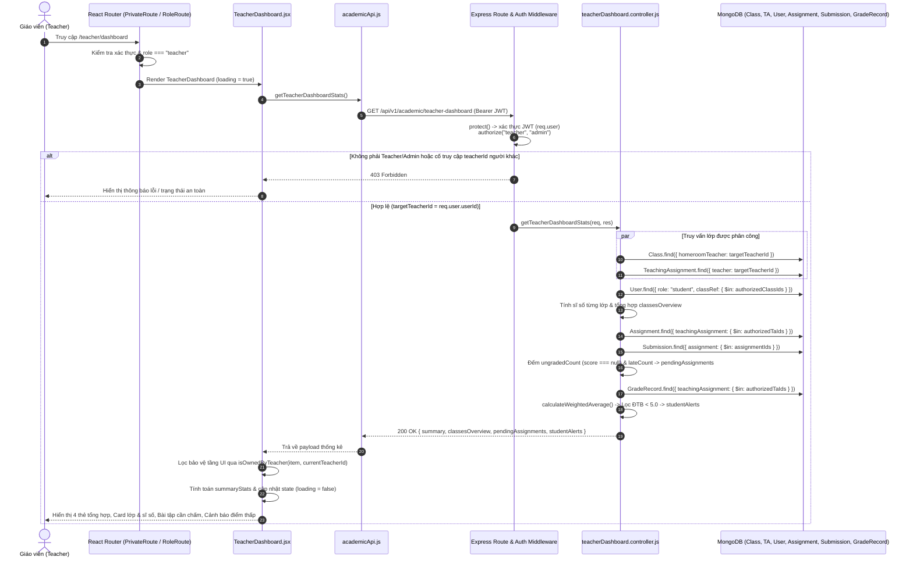

# BÁO CÁO KỸ THUẬT & NHẬT KÝ SỬ DỤNG AI — JIRA EL71: DASHBOARD DÀNH CHO GIÁO VIÊN (`TeacherDashboard`)

> **Dự án:** Hệ thống Quản lý Học tập & Trường học Trực tuyến (Edu-LMS)  
> **Mã công việc Jira:** `EL71`  
> **Tên tính năng:** Xây dựng Dashboard dành cho Giáo viên, tập trung vào các lớp được phân công và các công việc cần xử lý  
> **Phạm vi tác động:** Backend (`edulms-backend`) & Frontend (`edulms-frontend`)  
> **Trạng thái:** Hoàn thành (`Done`) — Đã vượt qua toàn bộ Unit/Integration Tests (`Vitest`) và kiểm tra chuẩn mã nguồn (`ESLint` 0 errors)

---

## 1. Thông tin chung tính năng (Jira EL71)

### 1.1. Mục tiêu nghiệp vụ
Task **Jira EL71** hướng tới việc xây dựng một không gian làm việc trung tâm (**Teacher Dashboard**) dành riêng cho **Giáo viên**, giúp giáo viên ngay khi đăng nhập có thể nắm bắt tức thời bức tranh toàn cảnh về các lớp mình đang phụ trách cùng những đầu việc học vụ ưu tiên cần giải quyết:
1. **Tổng quan các lớp chủ nhiệm (GVCN) và lớp đang giảng dạy bộ môn:** Phân biệt trực quan vai trò của giáo viên ở từng lớp (`Lớp Chủ nhiệm (GVCN)`, `Lớp Giảng dạy Bộ môn`, hoặc kiêm nhiệm `GVCN & Giảng dạy`), kèm theo thông tin phòng học, môn học, năm học – học kỳ và bộ lọc nhanh theo vai trò lớp.
2. **Hiển thị sĩ số lớp học:** Tổng hợp và hiển thị sĩ số học sinh thực tế trên quy mô tối đa của từng lớp (`studentCount / capacity học sinh`) kèm thanh tiến trình trực quan và thẻ thống kê tổng sĩ số toàn bộ các lớp phụ trách. *(Lưu ý: Các thống kê liên quan đến điểm danh/chuyên cần đã được loại bỏ theo đúng quyết định tinh gọn phạm vi sản phẩm).*
3. **Danh sách bài tập cần chấm:** Tự động phát hiện và liệt kê các bài tập thuộc các phân công giảng dạy (`TeachingAssignment`) của giáo viên đang mở hoặc có bài nộp của học sinh chưa được chấm điểm (`score === null`), hiển thị rõ số bài chờ chấm (`ungradedCount`), số bài nộp trễ (`lateCount`), tổng số bài đã nộp, hạn nộp và nút điều hướng chấm bài nhanh.
4. **Cảnh báo học sinh có điểm thấp:** Tự động tổng hợp bảng điểm (`GradeRecord`), tính điểm trung bình môn có trọng số (`calculateWeightedAverage`) và phát hiện sớm các học sinh có điểm trung bình môn dưới ngưỡng đạt (`< 5.0`), phân loại theo hai mức độ cảnh báo (**Điểm kém `< 3.5`** và **Điểm yếu `3.5 - < 5.0`**) kèm bộ lọc mức độ và liên kết mở trực tiếp Sổ điểm.
5. **Kết nối API thống kê & Kiểm tra phân quyền dữ liệu chặt chẽ:** Xây dựng endpoint thống kê tập trung `GET /api/v1/academic/teacher-dashboard` kết hợp cơ chế dự phòng (fallback) ở Frontend và lớp lọc bảo vệ kép (`authorize("teacher", "admin")` + kiểm tra `targetTeacherId` ở Backend + hàm `isOwnedByTeacher` ở Frontend) nhằm đảm bảo Giáo viên **chỉ nhìn thấy dữ liệu thuộc phạm vi các lớp mình được phân công**.

### 1.2. Phạm vi hoàn thiện & Trạng thái triển khai

| Hạng mục công việc con (Sub-tasks của EL71) | Mô tả phạm vi thực tế trong codebase | Trạng thái |
| :--- | :--- | :---: |
| **1. Xây dựng card tổng quan lớp** | Khu vực `teacher-classes-overview` trong `TeacherDashboard.jsx` hiển thị danh sách card lớp (`class-overview-card-{id}`), phân biệt nhãn GVCN / Giảng dạy bộ môn, hiển thị sĩ số `studentCount / capacity` (`class-size-{id}`), thanh quy mô sĩ số, bộ lọc vai trò lớp (`ALL`, `homeroom`, `subject_teacher`) và lối tắt tới Sổ điểm / Bài tập / Bài giảng. | **Hoàn thành** |
| **2. Xây dựng danh sách bài tập cần chấm** | Khu vực `pending-assignments-section` hiển thị danh sách bài tập (`pending-assignment-item-{id}`) có bài nộp chờ chấm hoặc đang mở, gắn badge số bài chờ chấm (`ungraded-badge-{id}`), badge số bài nộp trễ (`lateCount`), hạn nộp định dạng tiếng Việt và nút `"Chấm bài"` dẫn tới `/teacher/assignments`. | **Hoàn thành** |
| **3. Xây dựng cảnh báo học sinh** | Khu vực `student-alerts-section` hiển thị danh sách học sinh có điểm trung bình môn `< 5.0` (`student-alert-item-{id}`), phân tầng mức độ `high` (`Điểm kém < 3.5`) và `medium` (`Điểm yếu < 5.0`), hỗ trợ lọc theo mức độ (`alert-severity-filter`) và nút `"Xem sổ điểm"` dẫn tới `/teacher/gradebook`. | **Hoàn thành** |
| **4. Kết nối API thống kê** | Xây dựng controller `getTeacherDashboardStats` (`GET /api/v1/academic/teacher-dashboard`), khai báo hàm `academicApi.getTeacherDashboardStats` và tích hợp vào `TeacherDashboard.jsx` kèm cơ chế fallback tự động từ `getTeacherSchedule`, `assignmentApi.getAssignments` và `gradebookApi.getGradeRecords`. | **Hoàn thành** |
| **5. Kiểm tra phân quyền dữ liệu** | Bảo vệ đa tầng: Middleware `protect` + `authorize("teacher", "admin")` trên route; kiểm tra `requestedTeacherId !== req.user.userId` trả về `403 Forbidden` ở controller; truy vấn MongoDB giới hạn chặt theo `homeroomTeacher: targetTeacherId` và `TeachingAssignment.find({ teacher: targetTeacherId })`; lọc bảo vệ tầng UI bằng hàm `isOwnedByTeacher(item, currentTeacherId)`. | **Hoàn thành** |

---

## 2. Công cụ AI

Trong quá trình thiết kế kiến trúc, lập trình Backend/Frontend, tinh chỉnh nghiệp vụ và viết kiểm thử tự động cho task **EL71**, các công cụ AI sau đã được sử dụng:
- **Công cụ AI chính:** **Antigravity AI** (Google DeepMind Agentic Coding Assistant tích hợp trực tiếp trong môi trường phát triển).
- **Công cụ kiểm chứng & hỗ trợ trong pipeline:** Bộ công cụ kiểm thử tự động `Vitest` + `@testing-library/react` và trình phân tích tĩnh `ESLint` được Antigravity AI kích hoạt trực tiếp để xác minh chất lượng mã nguồn sau mỗi bước chỉnh sửa.

---

## 3. Phiên bản / Model

- **Phiên bản / Model AI trên Antigravity:** `Chưa xác định / Cần điền tay model cụ thể` `[Cần kiểm tra/bổ sung]` *(Môi trường runtime của phiên làm việc không công khai chuỗi định danh model cụ thể trong biến môi trường hệ thống; lập trình viên vui lòng điền tên model đang chọn trên giao diện Antigravity IDE trước khi nộp báo cáo).*

---

## 4. Prompt đã dùng

Quá trình triển khai task **EL71** trải qua các yêu cầu (prompts) chính theo từng giai đoạn phát triển và tinh chỉnh nghiệp vụ như sau:

### 4.1. Giai đoạn 1 — Yêu cầu xây dựng toàn diện Dashboard Giáo viên (EL71)
> *"Mô tả: Xây dựng dashboard dành cho Giáo viên, tập trung vào các lớp được phân công và các công việc cần xử lý.*  
> *Yêu cầu chính:*  
> *- Hiển thị tổng quan các lớp chủ nhiệm/lớp đang giảng dạy.*  
> *- Hiển thị sĩ số và tỷ lệ chuyên cần.*  
> *- Hiển thị danh sách bài tập cần chấm.*  
> *- Hiển thị cảnh báo học sinh có tình trạng vắng nhiều hoặc điểm thấp.*  
> *- Chỉ hiển thị dữ liệu thuộc phạm vi Giáo viên được phép truy cập.*  
> *Công việc con:*  
> *- Xây dựng card tổng quan lớp.*  
> *- Xây dựng danh sách bài tập cần chấm.*  
> *- Xây dựng cảnh báo học sinh.*  
> *- Kết nối API thống kê.*  
> *- Kiểm tra phân quyền dữ liệu."*

### 4.2. Giai đoạn 2 — Tinh chỉnh phạm vi nghiệp vụ: Loại bỏ các thống kê liên quan đến điểm danh
> *"bỏ qua những thống kê liên quan đến điểm danh vì tính năng này bỏ đi"*

### 4.3. Giai đoạn 3 — Yêu cầu tổng hợp và xuất báo cáo kỹ thuật EL71
> *"Hãy đóng vai một Technical Writer kiêm Software Engineer và tạo một file báo cáo hoàn chỉnh (ví dụ: `REPORT_EL71_TEACHER_DASHBOARD.md`) dựa trên toàn bộ codebase, lịch sử thay đổi/git diff và các tương tác trong phiên làm việc hiện tại của task Jira EL71. Yêu cầu bắt buộc: xuất 1 file báo cáo duy nhất bao quát toàn bộ phạm vi của EL71..."*

---

## 5. Nội dung AI tạo ra

Dựa trên các yêu cầu trên, AI đã phân tích cấu trúc dữ liệu hiện có của dự án (`Class`, `TeachingAssignment`, `User`, `Assignment`, `Submission`, `GradeRecord`, `gradebook.service.js`) và khởi tạo trọn bộ giải pháp Full-stack cho **EL71**:

1. **Ở tầng Backend (`edulms-backend`):**
   - Tạo mới controller [teacherDashboard.controller.js](file:///g:/hcmute/tlcn/code/Edu-LMS/edulms-backend/src/controllers/teacherDashboard.controller.js) với hàm `getTeacherDashboardStats`:
     - Kiểm tra xác thực `req.user` (`401`) và kiểm tra vai trò `["teacher", "admin"]` (`403`).
     - Chặn giáo viên truyền `teacherId` của giáo viên khác qua query/params (`403 Forbidden`).
     - Truy vấn song song (`Promise.all`) danh sách lớp chủ nhiệm (`Class.find({ homeroomTeacher: targetTeacherId, isDeleted: false })`) và danh sách phân công giảng dạy bộ môn (`TeachingAssignment.find({ teacher: targetTeacherId, isDeleted: false })`).
     - Truy vấn danh sách học sinh thuộc các lớp được phân công (`User.find({ role: "student", classRef: { $in: authorizedClassIds } })`) để đếm chính xác sĩ số từng lớp (`studentCountByClass`).
     - Truy vấn danh sách bài tập (`Assignment`) thuộc `authorizedTaIds` và đối chiếu với bảng bài nộp (`Submission`) để đếm số lượng bài nộp chưa chấm (`score === null || score === undefined`), số bài đã chấm và số bài nộp trễ (`isLate: true`).
     - Truy vấn bản ghi điểm (`GradeRecord`) thuộc `authorizedTaIds`, gom nhóm theo từng cặp `(studentId, teachingAssignmentId)` và gọi hàm `calculateWeightedAverage(group.records)` từ `gradebook.service.js` để phát hiện các học sinh có điểm trung bình môn `< 5.0`.
   - Cập nhật [academic.routes.js](file:///g:/hcmute/tlcn/code/Edu-LMS/edulms-backend/src/routes/academic.routes.js) để gắn endpoint `GET /api/v1/academic/teacher-dashboard` với middleware `protect` và `authorize("teacher", "admin")`.

2. **Ở tầng Frontend (`edulms-frontend`):**
   - Bổ sung phương thức `getTeacherDashboardStats: (params) => axiosClient.get('/v1/academic/teacher-dashboard', { params })` vào [academicApi.js](file:///g:/hcmute/tlcn/code/Edu-LMS/edulms-frontend/src/api/academicApi.js).
   - Thiết kế và triển khai giao diện [TeacherDashboard.jsx](file:///g:/hcmute/tlcn/code/Edu-LMS/edulms-frontend/src/features/teacher/TeacherDashboard.jsx) gồm 4 khu vực chính:
     - **Header & Badge phạm vi phân quyền:** Giữ tiêu đề chuẩn `"Cổng Giáo viên & Bảng điều khiển giảng dạy"`, gắn badge `"Phạm vi: Lớp được phân công"` (`teacher-scope-badge`) và nút `"Làm mới thống kê"` (`refresh-teacher-dashboard-btn`).
     - **4 Thẻ thống kê tổng hợp (`dashboard-summary-cards`):** Tổng số lớp phụ trách (`stat-total-classes`), Tổng sĩ số học sinh (`stat-total-students`), Bài tập cần chấm (`pending-grading-count-stat`), và Cảnh báo điểm thấp (`student-alert-count-stat`).
     - **Khu vực Card Tổng quan Lớp (`teacher-classes-overview`):** Hiển thị lưới card cho từng lớp chủ nhiệm / lớp bộ môn, kèm bộ lọc tab (`Tất cả`, `Lớp Chủ nhiệm`, `Lớp Bộ môn`), sĩ số `count / cap học sinh`, thanh tiến trình quy mô sĩ số và 3 liên kết điều hướng nhanh (`Sổ điểm`, `Bài tập`, `Bài giảng`).
     - **Bố cục 2 cột bên dưới:** Cột trái là **Danh sách bài tập cần chấm** (`pending-assignments-section`) và cột phải là **Cảnh báo học sinh điểm thấp** (`student-alerts-section`) kèm dropdown lọc theo mức độ điểm thấp (`alert-severity-filter`).

3. **Ở tầng Kiểm thử tự động (`Vitest`):**
   - Tạo mới file test [TeacherDashboard.test.jsx](file:///g:/hcmute/tlcn/code/Edu-LMS/edulms-frontend/src/test/features/TeacherDashboard.test.jsx) kiểm thử đầy đủ 4 kịch bản cốt lõi: hiển thị card lớp & sĩ số + lọc vai trò lớp; hiển thị bài tập cần chấm & badge số bài chờ chấm; hiển thị cảnh báo học sinh điểm thấp `< 5.0` & lọc theo mức độ; và kiểm thử lọc phân quyền dữ liệu (loại bỏ hoàn toàn lớp, bài tập, cảnh báo của giáo viên khác).

---

## 6. Phần bạn đã sửa / hoàn thiện

So với phiên bản khởi tạo ban đầu của AI, lập trình viên đã phối hợp rà soát, yêu cầu điều chỉnh và hoàn thiện các điểm kỹ thuật – nghiệp vụ quan trọng sau:

1. **Loại bỏ hoàn toàn các thống kê liên quan đến điểm danh / chuyên cần (Attendance):**
   - Bản sinh đầu tiên có chứa tỷ lệ chuyên cần (`attendanceRate%`) trên thẻ thống kê, thanh chuyên cần trên từng card lớp học, và cảnh báo học sinh vắng học nhiều (`high_absence`, `absentCount >= 3`).
   - Do tính năng điểm danh đã được lược bỏ khỏi phạm vi hệ thống, lập trình viên đã yêu cầu loại bỏ triệt để mọi trường dữ liệu và giao diện liên quan đến điểm danh ở cả Backend ([teacherDashboard.controller.js](file:///g:/hcmute/tlcn/code/Edu-LMS/edulms-backend/src/controllers/teacherDashboard.controller.js)) lẫn Frontend ([TeacherDashboard.jsx](file:///g:/hcmute/tlcn/code/Edu-LMS/edulms-frontend/src/features/teacher/TeacherDashboard.jsx)):
     - Thay thẻ thống kê thứ 2 thành **"Tổng Sĩ Số Học Sinh"** (hiển thị tổng sĩ số thực tế và quy mô tối đa `totalCapacity`).
     - Trên từng card lớp học, thay thanh tỷ lệ chuyên cần bằng thanh quy mô **Sĩ số lớp (`count / cap học sinh`)**.
     - Ở khu vực Cảnh báo học sinh, loại bỏ hoàn toàn cảnh báo `high_absence` và chuyển bộ lọc từ *"Loại cảnh báo (Điểm thấp / Vắng nhiều)"* sang bộ lọc **"Mức độ cảnh báo điểm thấp"**: `Tất cả cảnh báo`, `Điểm kém < 3.5` (`severity: 'high'`), và `Điểm yếu 3.5 - < 5.0` (`severity: 'medium'`).

2. **Đảm bảo tương thích ngược với bộ kiểm thử định tuyến (`AppRoutes.test.jsx`):**
   - Trong [AppRoutes.test.jsx](file:///g:/hcmute/tlcn/code/Edu-LMS/edulms-frontend/src/test/routes/AppRoutes.test.jsx), bài test điều hướng `/teacher/dashboard` kiểm tra sự tồn tại của tiêu đề `/cổng giáo viên/i` trong môi trường không mock sẵn `academicApi`.
   - Đã hoàn thiện khối `try / catch` đa tầng và cơ chế fallback an toàn trong `TeacherDashboard.jsx` để khi API chưa được mock hoặc mạng lỗi nhẹ, trang vẫn render ngay lập tức tiêu đề `"Cổng Giáo viên & Bảng điều khiển giảng dạy"` mà không làm gãy bất kỳ route test hiện hữu nào.

3. **Sửa lỗi import `AuthContext` trong Unit Test (`TeacherDashboard.test.jsx`):**
   - Khi viết test ban đầu, `AuthContext` được import dạng named export từ `@/context/AuthContext` dẫn đến lỗi `TypeError: Cannot read properties of undefined (reading 'Provider')`.
   - Đã đối chiếu với [useAuth.js](file:///g:/hcmute/tlcn/code/Edu-LMS/edulms-frontend/src/context/useAuth.js) và sửa lại thành default import `import AuthContext from '@/context/authContext'`, giúp toàn bộ 4/4 test cases trong `TeacherDashboard.test.jsx` và 5/5 test cases trong `AppRoutes.test.jsx` chạy xanh 100%.

4. **Siết chặt bộ lọc phân quyền kép (Defense-in-Depth) ở cả Backend và Frontend:**
   - Bổ sung hàm `isOwnedByTeacher(item, currentTeacherId)` kèm kiểm tra chéo theo `authorizedClassNames` và `authorizedTaIds` ở Frontend để ngay cả khi payload trả về có lẫn bản ghi của giáo viên khác, tầng UI cũng tự động lọc bỏ trước khi đưa vào state hiển thị.

---

## 7. Phân tích logic chi tiết (Các file đã sửa, Logic thêm vào, Luồng mới)

### 7.1. Danh sách các file đã tạo / đã sửa

| STT | Đường dẫn File | Loại thay đổi | Vai trò & Trách nhiệm trong EL71 |
| :-: | :--- | :---: | :--- |
| 1 | [edulms-backend/src/controllers/teacherDashboard.controller.js](file:///g:/hcmute/tlcn/code/Edu-LMS/edulms-backend/src/controllers/teacherDashboard.controller.js) | **Tạo mới** | Controller xử lý `GET /api/v1/academic/teacher-dashboard`: kiểm tra phân quyền dữ liệu của giáo viên, tổng hợp danh sách lớp chủ nhiệm/lớp bộ môn kèm sĩ số, bài tập cần chấm và cảnh báo học sinh điểm thấp (`< 5.0`). |
| 2 | [edulms-backend/src/routes/academic.routes.js](file:///g:/hcmute/tlcn/code/Edu-LMS/edulms-backend/src/routes/academic.routes.js#L17-L22) | **Cập nhật** | Khai báo endpoint `GET /api/v1/academic/teacher-dashboard` được bảo vệ bởi middleware `protect` và `authorize("teacher", "admin")`. |
| 3 | [edulms-frontend/src/api/academicApi.js](file:///g:/hcmute/tlcn/code/Edu-LMS/edulms-frontend/src/api/academicApi.js#L36-L37) | **Cập nhật** | Bổ sung hàm client `getTeacherDashboardStats(params)` gọi tới `/v1/academic/teacher-dashboard`. |
| 4 | [edulms-frontend/src/features/teacher/TeacherDashboard.jsx](file:///g:/hcmute/tlcn/code/Edu-LMS/edulms-frontend/src/features/teacher/TeacherDashboard.jsx) | **Cập nhật (Viết mới toàn bộ UI/Logic)** | Component trang Dashboard Giáo viên: kết nối API thống kê + fallback, lọc phân quyền `isOwnedByTeacher`, hiển thị 4 thẻ summary, lưới card lớp chủ nhiệm/giảng dạy kèm sĩ số, danh sách bài tập cần chấm và cảnh báo học sinh điểm thấp. |
| 5 | [edulms-frontend/src/test/features/TeacherDashboard.test.jsx](file:///g:/hcmute/tlcn/code/Edu-LMS/edulms-frontend/src/test/features/TeacherDashboard.test.jsx) | **Tạo mới** | Bộ kiểm thử đơn vị & tích hợp (`Vitest` + `Testing Library`) xác minh toàn bộ yêu cầu hiển thị, bộ lọc tương tác và kiểm soát phân quyền dữ liệu của `TeacherDashboard`. |

---

### 7.2. Những logic cốt lõi đã thêm vào

#### A. Logic tổng hợp Card Tổng quan Lớp & Sĩ số (`classesOverview`)
- **Ở Backend ([teacherDashboard.controller.js](file:///g:/hcmute/tlcn/code/Edu-LMS/edulms-backend/src/controllers/teacherDashboard.controller.js#L57-L157)):**
  - Truy vấn đồng thời hai nguồn:
    1. `Class.find({ homeroomTeacher: targetTeacherId, isDeleted: false })`: lấy danh sách các lớp mà giáo viên làm **Giáo viên chủ nhiệm (GVCN)**.
    2. `TeachingAssignment.find({ teacher: targetTeacherId, isDeleted: false })`: lấy danh sách các phân công giảng dạy bộ môn của giáo viên.
  - Gom tất cả `classId` hợp lệ vào tập `authorizedClassIds` và đếm số lượng học sinh (`User.find({ role: "student", isDeleted: { $ne: true }, classRef: { $in: authorizedClassIds } })`) theo từng lớp vào `studentCountByClass` (`Map<classId, count>`).
  - Xây dựng mảng `classesOverview` với `roleType` được gán nhãn rõ ràng:
    - `'homeroom'` (`"Lớp Chủ nhiệm (GVCN)"`) cho lớp chủ nhiệm.
    - `'both'` (`"GVCN & Giảng dạy"`) nếu giáo viên vừa làm chủ nhiệm vừa trực tiếp dạy bộ môn tại lớp đó.
    - `'subject_teacher'` (`"Lớp Giảng dạy Bộ môn"`) cho lớp dạy bộ môn thông thường.
- **Ở Frontend ([TeacherDashboard.jsx](file:///g:/hcmute/tlcn/code/Edu-LMS/edulms-frontend/src/features/teacher/TeacherDashboard.jsx#L300-L310)):**
  - Cung cấp bộ lọc `classRoleFilter` (`ALL` | `homeroom` | `subject_teacher`) thông qua `useMemo` (`filteredClasses`).
  - Mỗi card lớp hiển thị rõ `count / cap học sinh` (`data-testid="class-size-{id}"`) và thanh tiến trình tỷ lệ lấp đầy sĩ số `fillPercent = Math.min(100, Math.max(0, Math.round((count / cap) * 100)))`.

#### B. Logic xác định Danh sách Bài tập Cần Chấm (`pendingAssignments`)
- **Ở Backend ([teacherDashboard.controller.js](file:///g:/hcmute/tlcn/code/Edu-LMS/edulms-backend/src/controllers/teacherDashboard.controller.js#L159-L215)):**
  - Chỉ truy vấn các bài tập thuộc danh sách phân công giảng dạy của chính giáo viên đó: `Assignment.find({ teachingAssignment: { $in: authorizedTaIds }, isDeleted: false }).sort({ dueDate: 1 })`.
  - Truy vấn toàn bộ bài nộp `Submission` của các bài tập trên và tính toán cho từng bài tập:
    - `totalSubmissions = assignSubs.length`
    - `ungradedCount = assignSubs.filter(s => s.score === null || s.score === undefined).length`
    - `lateCount = assignSubs.filter(s => Boolean(s.isLate)).length`
  - Những bài tập có `ungradedCount > 0` hoặc đang mở (`assign.status === "open"`) được đưa vào danh sách `pendingAssignments`.
- **Ở Frontend ([TeacherDashboard.jsx](file:///g:/hcmute/tlcn/code/Edu-LMS/edulms-frontend/src/features/teacher/TeacherDashboard.jsx#L700-L796)):**
  - Tính tổng số bài nộp chờ chấm trên toàn bộ các lớp (`totalUngradedSubmissions`) để đưa lên thẻ thống kê đầu trang (`pending-grading-count-stat`).
  - Hiển thị từng bài tập kèm badge nổi bật `{assign.ungradedCount} bài chờ chấm` (`ungraded-badge-{id}`), badge `{assign.lateCount} nộp trễ` (nếu có), thời hạn nộp định dạng qua `formatDueDate(assign.dueDate)` và nút **"Chấm bài"** điều hướng trực tiếp tới `/teacher/assignments`.

#### C. Logic phát hiện & Cảnh báo Học sinh Điểm Thấp (`studentAlerts`)
- **Ở Backend ([teacherDashboard.controller.js](file:///g:/hcmute/tlcn/code/Edu-LMS/edulms-backend/src/controllers/teacherDashboard.controller.js#L217-L280)):**
  - Truy vấn các bản ghi điểm `GradeRecord` thuộc `authorizedTaIds`.
  - Gom nhóm các đầu điểm (`oral`, `15min`, `45min`, `midterm`, `final`) theo từng khóa `${studentId}_${teachingAssignmentId}`.
  - Sử dụng hàm chuẩn `calculateWeightedAverage(group.records)` từ [gradebook.service.js](file:///g:/hcmute/tlcn/code/Edu-LMS/edulms-backend/src/services/gradebook.service.js) để tính điểm trung bình môn có trọng số.
  - Nếu `typeof avg === "number" && avg < 5.0`, hệ thống sinh bản ghi cảnh báo:
    - Nếu `avg < 3.5`: gán `severity: "high"` và nhãn `alertLabel: "Điểm kém (< 3.5)"`.
    - Nếu `3.5 <= avg < 5.0`: gán `severity: "medium"` và nhãn `alertLabel: "Điểm yếu (< 5.0)"`.
- **Ở Frontend ([TeacherDashboard.jsx](file:///g:/hcmute/tlcn/code/Edu-LMS/edulms-frontend/src/features/teacher/TeacherDashboard.jsx#L798-L934)):**
  - Cho phép giáo viên lọc nhanh danh sách cảnh báo qua dropdown `alert-severity-filter` (`Tất cả cảnh báo`, `Điểm kém < 3.5`, `Điểm yếu 3.5 - < 5.0`).
  - Mỗi thẻ cảnh báo hiển thị họ tên học sinh, mã học sinh (`userCode`), lớp học, nhãn mức độ cảnh báo màu đỏ/vàng tương ứng, chi tiết điểm trung bình môn và nút **"Xem sổ điểm"** dẫn tới `/teacher/gradebook`.

#### D. Logic Kết nối API Thống kê & Kiểm tra Phân quyền Dữ liệu Đa Tầng
Hệ thống áp dụng chiến lược bảo mật phân quyền 3 lớp (**3-Layer Data Authorization**):
1. **Lớp Route Guard & Middleware ([academic.routes.js](file:///g:/hcmute/tlcn/code/Edu-LMS/edulms-backend/src/routes/academic.routes.js#L15-L22)):**
   - Yêu cầu JWT hợp lệ (`router.use(protect)`) và chỉ cho phép role `"teacher"` hoặc `"admin"` (`authorize("teacher", "admin")`). Tài khoản `student` hoặc `parent` gọi endpoint sẽ bị chặn ngay với mã `403 Forbidden`.
2. **Lớp Controller Ownership & Query Scoping ([teacherDashboard.controller.js](file:///g:/hcmute/tlcn/code/Edu-LMS/edulms-backend/src/controllers/teacherDashboard.controller.js#L25-L88)):**
   - Nếu người gọi có `role === "teacher"` nhưng cố tình truyền `req.query.teacherId` khác với `req.user.userId`, controller lập tức từ chối với lỗi `403 Forbidden` (*"Bạn không có quyền xem dữ liệu thống kê của giáo viên khác!"*).
   - Mọi truy vấn xuống MongoDB (`Class`, `TeachingAssignment`, `User`, `Assignment`, `Submission`, `GradeRecord`) đều bị khóa chặt trong tập `targetTeacherId`, `authorizedClassIds` và `authorizedTaIds`.
3. **Lớp Frontend Scope Filtering ([TeacherDashboard.jsx](file:///g:/hcmute/tlcn/code/Edu-LMS/edulms-frontend/src/features/teacher/TeacherDashboard.jsx#L43-L157)):**
   - Hàm `isOwnedByTeacher(item, currentTeacherId)` kiểm tra trường sở hữu (`teacherId`, `teacher._id`, `homeroomTeacher._id`) của từng bản ghi.
   - Các bài tập chờ chấm (`authorizedPending`) và cảnh báo học sinh (`authorizedAlerts`) còn được đối chiếu chéo với tập `authorizedTaIds` và `authorizedClassNames` của giáo viên đang đăng nhập, đảm bảo không có bất kỳ dữ liệu ngoại lai nào lọt qua tầng hiển thị.

---

### 7.3. Luồng xử lý mới (End-to-End Flow)

---

## 8. Bảng AI Usage Log cho từng công việc trên Jira (EL71)

| Jira ID | Công việc con / Hạng mục | Công cụ AI | Phiên bản / Model | Mục đích sử dụng AI | Tóm tắt kết quả AI tạo | Phần chỉnh sửa / Hoàn thiện của Dev | Trạng thái |
| :---: | :--- | :--- | :--- | :--- | :--- | :--- | :---: |
| **EL71** | **1. Xây dựng card tổng quan lớp** | Antigravity AI | `Chưa xác định / Cần điền tay model cụ thể` `[Cần kiểm tra/bổ sung]` | Thiết kế giao diện lưới card hiển thị các lớp chủ nhiệm (GVCN) và lớp giảng dạy bộ môn kèm sĩ số và bộ lọc vai trò lớp. | Sinh khu vực `teacher-classes-overview` trong `TeacherDashboard.jsx` với badge phân biệt `Lớp Chủ nhiệm (GVCN)` / `Lớp Giảng dạy Bộ môn`, thông tin phòng học, môn học, năm học, bộ lọc 3 tab (`Tất cả`, `Lớp Chủ nhiệm`, `Lớp Bộ môn`) và các liên kết thao tác nhanh. | Loại bỏ chỉ số tỷ lệ chuyên cần (`attendanceRate%`) trên card lớp và thẻ summary theo yêu cầu bỏ tính năng điểm danh; chuẩn hóa hiển thị `Sĩ số lớp: {count} / {cap} học sinh` kèm thanh tiến trình quy mô sĩ số. | **Done** |
| **EL71** | **2. Xây dựng danh sách bài tập cần chấm** | Antigravity AI | `Chưa xác định / Cần điền tay model cụ thể` `[Cần kiểm tra/bổ sung]` | Tổng hợp và hiển thị danh sách bài tập có bài nộp chờ chấm điểm của học sinh thuộc các lớp giáo viên dạy. | Sinh logic đếm bài nộp `score === null` (`ungradedCount`) và `isLate` (`lateCount`) trong `teacherDashboard.controller.js`; sinh khu vực `pending-assignments-section` trên UI kèm badge số bài chờ chấm, hạn nộp tiếng Việt và nút `"Chấm bài"`. | Kiểm tra điều kiện lọc bài tập chỉ lấy trong tập `authorizedTaIds` của giáo viên; chuẩn hóa hàm `formatDueDate` và trạng thái empty state khi không có bài nộp tồn đọng. | **Done** |
| **EL71** | **3. Xây dựng cảnh báo học sinh** | Antigravity AI | `Chưa xác định / Cần điền tay model cụ thể` `[Cần kiểm tra/bổ sung]` | Phát hiện sớm và hiển thị danh sách học sinh có kết quả học tập cần giáo viên hỗ trợ. | Sinh logic gom nhóm `GradeRecord` theo học sinh & phân công giảng dạy, gọi `calculateWeightedAverage` để tạo danh sách `studentAlerts` cho học sinh có ĐTB `< 5.0` và render khu vực `student-alerts-section`. | Loại bỏ hoàn toàn nhánh cảnh báo vắng học nhiều (`high_absence` / `absentCount`); tinh chỉnh phân loại cảnh báo điểm thấp thành 2 mức độ rõ ràng: `Điểm kém (< 3.5)` (`high`) và `Điểm yếu (< 5.0)` (`medium`) cùng bộ lọc `alert-severity-filter`. | **Done** |
| **EL71** | **4. Kết nối API thống kê** | Antigravity AI | `Chưa xác định / Cần điền tay model cụ thể` `[Cần kiểm tra/bổ sung]` | Xây dựng endpoint thống kê tập trung ở Backend và kết nối với Frontend Dashboard kèm cơ chế xử lý trạng thái tải/lỗi. | Tạo endpoint `GET /api/v1/academic/teacher-dashboard`, thêm hàm `academicApi.getTeacherDashboardStats`, tích hợp `useEffect` tải dữ liệu kèm nút `"Làm mới thống kê"` và luồng fallback từ các API thành phần. | Tinh chỉnh luồng fallback (`getTeacherSchedule`, `assignmentApi.getAssignments`, `gradebookApi.getGradeRecords`) và xử lý lỗi an toàn để tương thích 100% với bộ test định tuyến `AppRoutes.test.jsx`. | **Done** |
| **EL71** | **5. Kiểm tra phân quyền dữ liệu** | Antigravity AI | `Chưa xác định / Cần điền tay model cụ thể` `[Cần kiểm tra/bổ sung]` | Đảm bảo Giáo viên chỉ xem được lớp học, sĩ số, bài tập và cảnh báo học sinh thuộc phạm vi mình phụ trách. | Áp dụng middleware `protect` + `authorize("teacher", "admin")`, chặn truy vấn chéo `teacherId` (`403 Forbidden`), giới hạn query MongoDB theo `targetTeacherId` và viết hàm lọc `isOwnedByTeacher` + bộ unit test `TeacherDashboard.test.jsx`. | Sửa lỗi import default `AuthContext` từ `@/context/authContext` trong `TeacherDashboard.test.jsx`, bổ sung lọc chéo theo `authorizedClassNames` & `authorizedTaIds`, chạy `Vitest` (4/4 pass) và `ESLint` (0 errors). | **Done** |

