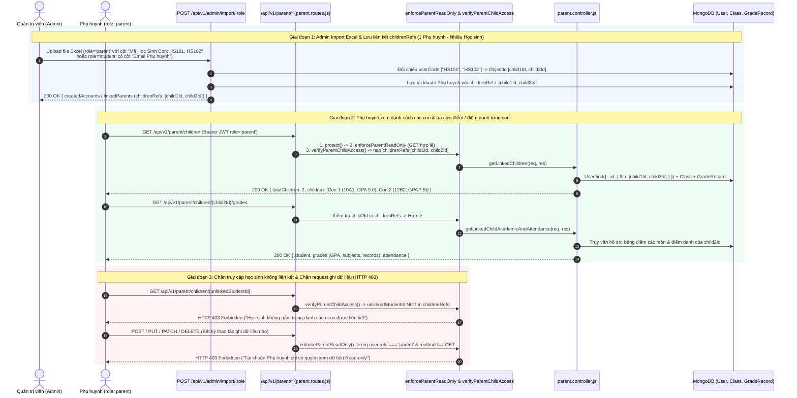

# BÁO CÁO KỸ THUẬT & NHẬT KÝ SỬ DỤNG AI — JIRA EL74: QUẢN LÝ TÀI KHOẢN PHỤ HUYNH & LIÊN KẾT HỌC SINH (`childrenRefs`)

> **Dự án:** Hệ thống Quản lý Học tập & Trường học Trực tuyến (Edu-LMS)  
> **Mã công việc Jira:** `EL74`  
> **Tên tính năng:** Mở rộng cơ chế quản lý tài khoản Phụ huynh, cho phép Admin liên kết một tài khoản Phụ huynh với một hoặc nhiều học sinh và cung cấp API truy vấn dữ liệu học sinh được liên kết  
> **Phạm vi tác động:** Backend (`edulms-backend`) & Frontend (`edulms-frontend`)  
> **Trạng thái:** Hoàn thành (`Done`) — Đã vượt qua toàn bộ bộ kiểm thử tự động (`Jest` 17/17 tests PASS trong `parentAccount.test.js`) và kiểm tra chuẩn mã nguồn (`ESLint` 0 errors)

---

## 1. Thông tin chung tính năng (Jira EL74)

### 1.1. Mục tiêu nghiệp vụ & kỹ thuật
Task **Jira EL74** giải quyết bài toán liên kết quan hệ **1 Phụ huynh – Nhiều Học sinh (`1:N`)** trong hệ thống quản lý trường học **Edu-LMS**, đồng thời thiết lập cơ chế phân quyền truy cập dữ liệu con cái và giới hạn quyền chỉ đọc (`Read-only`) chặt chẽ đối với tài khoản Phụ huynh:
1. **Mở rộng chức năng Import Excel hỗ trợ thông tin liên kết Phụ huynh – Học sinh:**
   - Hỗ trợ import trực tiếp danh sách tài khoản Phụ huynh (`POST /api/v1/admin/import/parent`) với cột `"Mã Học Sinh Con"` chứa một hoặc nhiều mã học sinh (ví dụ: `"HS001, HS002"`).
   - Hỗ trợ khai báo các cột thông tin Phụ huynh (`"Họ tên Phụ huynh"`, `"Mã Phụ huynh"`, `"Email Phụ huynh"`, `"Số điện thoại PH"`) đi kèm ngay trên file Import Học sinh (`POST /api/v1/admin/import/student`). Khi nhiều học sinh có chung Email hoặc Mã Phụ huynh, hệ thống tự động gom nhóm vào cùng một tài khoản Phụ huynh.
2. **Xử lý và lưu danh sách học sinh được liên kết vào `childrenRefs`:**
   - Mở rộng schema `User` với trường `childrenRefs: [{ type: mongoose.Schema.Types.ObjectId, ref: "User" }]`.
   - Cung cấp thêm API quản trị `PUT / POST /api/v1/admin/parents/:parentId/children` để Admin liên kết hoặc bổ sung (`mode: "replace" | "append"`) một hoặc nhiều học sinh vào `childrenRefs` của Phụ huynh bất kỳ lúc nào.
3. **API lấy danh sách học sinh thuộc tài khoản Phụ huynh (`GET /api/v1/parent/children`):**
   - Trả về danh sách toàn bộ các học sinh nằm trong `childrenRefs` của Phụ huynh đang đăng nhập kèm thông tin lớp học, phòng học, giáo viên chủ nhiệm (GVCN), điểm trung bình hiện tại (`currentGPA`, `academicPerformance`) và tỷ lệ chuyên cần (`attendanceRate`, `absentCount`).
4. **API lấy điểm và điểm danh của từng học sinh được liên kết (`GET /api/v1/parent/children/:studentId`, `/grades`, `/attendance`):**
   - Trả về chi tiết bảng điểm theo từng môn học/học kỳ (`grades`: `currentGPA`, `academicPerformance`, `subjects`, `records`) và thông tin điểm danh/chuyên cần (`attendance`: `attendanceRate`, `totalSessions`, `presentCount`, `absentCount`, `excusedAbsentCount`, `unexcusedAbsentCount`, `status`) của từng người con.
   - Đồng thời tích hợp kiểm tra `childrenRefs` vào hệ thống API Sổ điểm chung (`GET /api/v1/gradebook?studentId=...`).
5. **Kiểm tra quyền truy cập theo `role = parent` + `childrenRefs` & Giới hạn quyền chỉ đọc (`Read-only`):**
   - Mọi truy vấn dữ liệu học sinh của Phụ huynh đều được đối chiếu với mảng `childrenRefs`; nếu `studentId` không nằm trong `childrenRefs`, hệ thống trả về ngay **HTTP `403 Forbidden`**.
   - Xây dựng middleware `enforceParentReadOnly` chỉ cho phép `role = "parent"` thực hiện các HTTP method đọc dữ liệu (`GET`, `HEAD`, `OPTIONS`) và từ chối toàn bộ các request ghi dữ liệu (`POST`, `PUT`, `PATCH`, `DELETE`) với mã **HTTP `403 Forbidden`**.

### 1.2. Phạm vi hoàn thiện & Trạng thái triển khai

| Hạng mục công việc con (Sub-tasks của EL74) | Mô tả phạm vi thực tế trong codebase | Trạng thái |
| :--- | :--- | :---: |
| **1. Mở rộng Import Excel hỗ trợ cột thông tin Phụ huynh** | Mở rộng `import.service.js`, `import.controller.js` và giao diện `ImportUsersPage.jsx` hỗ trợ `role = "parent"` (`Mã Học Sinh Con`) và các cột `Họ tên Phụ huynh`, `Mã Phụ huynh`, `Email Phụ huynh`, `Số điện thoại PH` trên file `student` cùng file mẫu `.xlsx` tương ứng. | **Hoàn thành** |
| **2. Xử lý và lưu `childrenRefs`** | Bổ sung trường `childrenRefs` (mảng `ObjectId` tham chiếu `User`) và index `{ role: 1, childrenRefs: 1 }` trong `User.js`; xử lý ánh xạ `userCode -> ObjectId`, loại bỏ trùng lặp (`Set`) và gộp nhiều học sinh vào `childrenRefs` khi import hoặc qua API Admin `linkParentWithChildren`. | **Hoàn thành** |
| **3. Xây dựng API lấy danh sách học sinh được liên kết** | Xây dựng controller `getLinkedChildren` (`GET /api/v1/parent/children`) trong `parent.controller.js` trả về danh sách toàn bộ các học sinh trong `childrenRefs` theo đúng thứ tự liên kết kèm tóm tắt GPA, học lực, lớp học, GVCN và chuyên cần. | **Hoàn thành** |
| **4. Xây dựng API truy vấn điểm/điểm danh của con** | Xây dựng controller `getLinkedChildAcademicAndAttendance` (`GET /api/v1/parent/children/:studentId`, `/grades`, `/attendance`) và tích hợp kiểm tra `childrenRefs` vào `gradeRecordPermission.middleware.js` & `gradebook.service.js`. | **Hoàn thành** |
| **5. Xây dựng middleware giới hạn quyền ghi đối với Parent** | Xây dựng middleware `enforceParentReadOnly` và `verifyParentChildAccess` trong `parentPermission.middleware.js` chặn toàn bộ request `POST`, `PUT`, `PATCH`, `DELETE` từ `role === "parent"` với mã `403 Forbidden`. | **Hoàn thành** |
| **6. Kiểm thử trường hợp một Parent có nhiều học sinh** | Xây dựng bộ kiểm thử `edulms-backend/tests/parentAccount.test.js` với **17 test cases** kiểm tra import 1 phụ huynh có 2 con, truy vấn danh sách 2 con, truy vấn điểm/điểm danh từng con, chặn `403` khi xem học sinh ngoài `childrenRefs` và chặn `403` với mọi request ghi dữ liệu. | **Hoàn thành** |

---

## 2. Công cụ AI

Trong quá trình thiết kế schema, mở rộng bộ xử lý Excel, xây dựng API/Middleware phân quyền và viết kiểm thử tự động cho task **EL74**, các công cụ AI sau đã được sử dụng:
- **Công cụ AI chính:** **Antigravity AI** (Google DeepMind Agentic Coding Assistant tích hợp trực tiếp trong môi trường phát triển).
- **Công cụ kiểm thử & phân tích tĩnh:** `Jest` (Backend unit & pipeline integration tests) và `ESLint` (kiểm tra quy chuẩn mã nguồn trên cả `edulms-backend` và `edulms-frontend`).

---

## 3. Phiên bản / Model

- **Phiên bản / Model AI trên Antigravity:** `Chưa xác định / Cần điền tay model cụ thể` `[Cần kiểm tra/bổ sung]` *(Môi trường thực thi không công khai chuỗi định danh model cụ thể trong biến hệ thống; lập trình viên vui lòng điền tên model đang chọn trên thanh công cụ Antigravity IDE trước khi nộp báo cáo).*

---

## 4. Prompt đã dùng

Quá trình triển khai và hoàn thiện task **EL74** được thực hiện qua các prompt chính theo từng giai đoạn sau:

### 4.1. Giai đoạn 1 — Yêu cầu mở rộng quản lý tài khoản Phụ huynh, liên kết `childrenRefs` & phân quyền chỉ đọc (EL74)
> *"Mô tả: Mở rộng cơ chế quản lý tài khoản Phụ huynh, cho phép Admin liên kết một tài khoản Phụ huynh với một hoặc nhiều học sinh và cung cấp API để truy vấn dữ liệu của các học sinh được liên kết.*  
> *Yêu cầu chính:*  
> *- Mở rộng chức năng Import Excel để hỗ trợ thông tin liên kết Phụ huynh – Học sinh.*  
> *- Lưu danh sách học sinh được liên kết vào childrenRefs.*  
> *- API lấy danh sách học sinh thuộc tài khoản Phụ huynh.*  
> *- API lấy điểm và điểm danh của từng học sinh được liên kết.*  
> *- Kiểm tra quyền truy cập dựa trên role = parent và childrenRefs.*  
> *- Phụ huynh chỉ được phép thực hiện các API đọc dữ liệu.*  
> *- Từ chối các request ghi dữ liệu từ role parent.*  
> *Công việc con:*  
> *- Mở rộng Import Excel hỗ trợ cột thông tin Phụ huynh.*  
> *- Xử lý và lưu childrenRefs.*  
> *- Xây dựng API lấy danh sách học sinh được liên kết.*  
> *- Xây dựng API truy vấn điểm/điểm danh của con.*  
> *- Xây dựng middleware giới hạn quyền ghi đối với Parent.*  
> *- Kiểm thử trường hợp một Parent có nhiều học sinh"*

### 4.2. Giai đoạn 2 — Yêu cầu tổng hợp và xuất báo cáo kỹ thuật EL74
> *"Hãy đóng vai một Technical Writer kiêm Software Engineer và tạo một file báo cáo hoàn chỉnh (ví dụ: `REPORT_EL74_PARENT_LINKING_API.md`) dựa trên toàn bộ codebase, lịch sử thay đổi/git diff và các tương tác trong phiên làm việc hiện tại của task Jira EL74. Yêu cầu bắt buộc: xuất 1 file báo cáo duy nhất bao quát toàn bộ phạm vi của EL74..."*

---

## 5. Nội dung AI tạo ra

Từ đặc tả nghiệp vụ của **EL74**, AI đã thiết kế và sinh ra các thành phần mã nguồn sau trên cả Backend và Frontend:

1. **Mở rộng Schema `User` ([edulms-backend/src/models/User.js](file:///g:/hcmute/tlcn/code/Edu-LMS/edulms-backend/src/models/User.js)):**
   - Thêm trường `childrenRefs: [{ type: mongoose.Schema.Types.ObjectId, ref: "User" }]`, `phone: { type: String, default: null }`, `isDeleted: { type: Boolean, default: false }`.
   - Tạo compound index `userSchema.index({ role: 1, childrenRefs: 1 })` để tối ưu truy vấn tài khoản Phụ huynh và danh sách con.

2. **Mở rộng Parser & Service Import Excel ([edulms-backend/src/services/import.service.js](file:///g:/hcmute/tlcn/code/Edu-LMS/edulms-backend/src/services/import.service.js)) & Controller ([edulms-backend/src/controllers/import.controller.js](file:///g:/hcmute/tlcn/code/Edu-LMS/edulms-backend/src/controllers/import.controller.js)):**
   - Hàm `parseStudentCodesList(rawInput)`: tách chuỗi chứa nhiều mã học sinh ngăn cách bởi dấu phẩy, chấm phẩy hoặc gạch đứng (`"HS001, HS002; HS003"`) và khử trùng lặp (`Set`).
   - Mở rộng `validateRow(row, role)`:
     - Khi `role === "parent"`: đọc cột `"Mã Học Sinh Con"` / `"Mã Học Sinh Liên Kết"` / `"Danh sách Mã HS"`, báo lỗi nếu thiếu mã học sinh để liên kết.
     - Khi `role === "student"`: đọc thêm các cột `"Họ tên Phụ huynh"`, `"Mã Phụ huynh"`, `"Email Phụ huynh"`, `"Số điện thoại PH"`, kiểm tra định dạng email phụ huynh nếu có.
   - Mở rộng `processImport(fileBuffer, role)`:
     - Với `role === "parent"`: truy vấn `User.find({ userCode: { $in: allChildCodes }, role: "student" })`, báo lỗi chi tiết dòng nào có mã học sinh chưa tồn tại, và chuyển danh sách mã học sinh hợp lệ thành mảng `ObjectId` lưu vào `childrenRefs`.
     - Với `role === "student"`: sau khi tạo học sinh, tự động gom nhóm các dòng có thông tin Phụ huynh theo `email` hoặc `userCode` của Phụ huynh (`parentGroups`). Nếu Phụ huynh đã tồn tại trong DB thì gộp thêm `_id` của học sinh mới vào `childrenRefs` (không ghi đè con cũ); nếu chưa tồn tại thì tự động khởi tạo tài khoản Phụ huynh (`role: "parent"`) với `childrenRefs` chứa toàn bộ các con thuộc phụ huynh đó trong file Excel.
   - Mở rộng `generateTemplate(role)` và giao diện [ImportUsersPage.jsx](file:///g:/hcmute/tlcn/code/Edu-LMS/edulms-frontend/src/features/admin/ImportUsersPage.jsx) để hỗ trợ tải file mẫu và import cho cả 3 vai trò: `student`, `teacher`, `parent`.

3. **Middleware Kiểm tra Quyền `childrenRefs` & Giới hạn Quyền Ghi ([edulms-backend/src/middlewares/parentPermission.middleware.js](file:///g:/hcmute/tlcn/code/Edu-LMS/edulms-backend/src/middlewares/parentPermission.middleware.js)):**
   - `enforceParentReadOnly`: Kiểm tra nếu `req.user.role === "parent"` và `req.method` thuộc nhóm ghi dữ liệu (`POST`, `PUT`, `PATCH`, `DELETE` hoặc không thuộc `["GET", "HEAD", "OPTIONS"]`) thì chặn ngay với mã **HTTP `403 Forbidden`**.
   - `verifyParentChildAccess`: Xác thực `req.user.role === "parent"`, nạp danh sách `childrenRefs` từ CSDL vào `req.authorizedChildrenIds`, và nếu request có `studentId` (`params` hoặc `query`) thì kiểm tra `authorizedChildrenIds.includes(targetStudentId)`. Nếu học sinh không thuộc `childrenRefs`, trả về **HTTP `403 Forbidden`**.

4. **Controller & Routes Cổng Phụ huynh ([edulms-backend/src/controllers/parent.controller.js](file:///g:/hcmute/tlcn/code/Edu-LMS/edulms-backend/src/controllers/parent.controller.js) & [edulms-backend/src/routes/parent.routes.js](file:///g:/hcmute/tlcn/code/Edu-LMS/edulms-backend/src/routes/parent.routes.js)):**
   - `GET /api/v1/parent/children` (`getLinkedChildren`): Lấy danh sách toàn bộ học sinh trong `childrenRefs` của Phụ huynh kèm GPA, học lực, lớp học, GVCN và chuyên cần.
   - `GET /api/v1/parent/children/:studentId`, `/grades`, `/attendance` (`getLinkedChildAcademicAndAttendance`): Lấy chi tiết bảng điểm từng môn/học kỳ và thông tin điểm danh/chuyên cần của từng học sinh được liên kết.
   - `PUT / POST /api/v1/admin/parents/:parentId/children` (`linkParentWithChildren`): API dành cho Admin liên kết hoặc cập nhật danh sách `childrenRefs` cho tài khoản Phụ huynh.
   - Cập nhật [gradeRecordPermission.middleware.js](file:///g:/hcmute/tlcn/code/Edu-LMS/edulms-backend/src/middlewares/gradeRecordPermission.middleware.js#L240-L271) và [gradebook.service.js](file:///g:/hcmute/tlcn/code/Edu-LMS/edulms-backend/src/services/gradebook.service.js#L805-L834) để áp dụng kiểm tra `childrenRefs` khi Phụ huynh gọi API `/api/v1/gradebook`.

5. **Bộ Kiểm thử Tự động ([edulms-backend/tests/parentAccount.test.js](file:///g:/hcmute/tlcn/code/Edu-LMS/edulms-backend/tests/parentAccount.test.js)):**
   - Gồm **17 test cases** bao phủ toàn bộ 6 công việc con của **EL74**, đặc biệt là kịch bản một Phụ huynh liên kết nhiều học sinh (`child1Id` lớp `10A1` và `child2Id` lớp `12B2`).

---

## 6. Phần bạn đã sửa / hoàn thiện

Trong quá trình rà soát và chạy kiểm thử tích hợp, lập trình viên đã thực hiện các chỉnh sửa và hoàn thiện sau so với bản sinh ban đầu:

1. **Hỗ trợ song song 2 luồng Import Excel liên kết Phụ huynh – Học sinh & giữ tương thích ngược với `import.test.js`:**
   - Trong [import.test.js](file:///g:/hcmute/tlcn/code/Edu-LMS/edulms-backend/tests/import.test.js), các bài test cũ import học sinh chỉ có 4 cột (`Họ và Tên`, `Mã Học Sinh`, `Email`, `Lớp`) và mock `User.find` trả về `{ select: jest.fn().mockResolvedValue([]) }`.
   - Đã tinh chỉnh `validateRow` và `processImport` trong [import.service.js](file:///g:/hcmute/tlcn/code/Edu-LMS/edulms-backend/src/services/import.service.js) để các cột Phụ huynh trên sheet Học sinh là tùy chọn (optional) — khi không có cột Phụ huynh thì luồng import học sinh hoạt động y hệt cũ (không phát sinh truy vấn phụ), còn khi có cột Phụ huynh hoặc khi import theo `role = "parent"` thì hệ thống tự động kích hoạt bộ ánh xạ và gộp `childrenRefs`.

2. **Xử lý gộp không trùng lặp (`Deduplication & Merge`) khi một Phụ huynh có nhiều con:**
   - Khi import file Excel có nhiều dòng học sinh cùng khai báo một Email/Mã Phụ huynh (ví dụ: 2 anh chị em ruột học lớp `10A1` và `12B2`), `processImport` sử dụng `Map` (`parentGroups`) gom toàn bộ `_id` của các con vào chung một mảng `childrenRefs` trước khi tạo mới hoặc cập nhật tài khoản Phụ huynh.
   - Khi Phụ huynh đã tồn tại sẵn trong CSDL, hệ thống dùng `[...new Set([...currentRefs, ...newRefs])]` để nối thêm con mới mà không làm mất liên kết với các con đã có trước đó.

3. **Đồng bộ kiểm tra `childrenRefs` trên cả `/api/v1/parent/*` lẫn `/api/v1/gradebook`:**
   - Ngoài các route chuyên biệt trong `parent.routes.js`, giao diện tra cứu điểm của hệ thống còn sử dụng endpoint `/api/v1/gradebook`. Do đó, lập trình viên đã bổ sung nhánh `else if (role === "parent")` vào cả `canViewGradeRecords` ([gradeRecordPermission.middleware.js](file:///g:/hcmute/tlcn/code/Edu-LMS/edulms-backend/src/middlewares/gradeRecordPermission.middleware.js#L240-L271)) và `getGradeRecords` ([gradebook.service.js](file:///g:/hcmute/tlcn/code/Edu-LMS/edulms-backend/src/services/gradebook.service.js#L805-L834)) để đảm bảo Phụ huynh gọi bất kỳ API điểm số nào cũng bị kiểm tra chặt theo `childrenRefs`.

4. **Khắc phục lỗi ESLint `no-unused-vars` trong `parent.controller.js`:**
   - Loại bỏ biến `TeachingAssignment` được require nhưng không sử dụng trực tiếp tại dòng 4 của [parent.controller.js](file:///g:/hcmute/tlcn/code/Edu-LMS/edulms-backend/src/controllers/parent.controller.js), giúp `npm --prefix edulms-backend run lint` đạt **0 errors, 0 warnings**.

---

## 7. Phân tích logic chi tiết (Các file đã sửa, Logic thêm vào, Luồng mới)

### 7.1. Danh sách các file đã tạo / đã sửa

| STT | Đường dẫn File | Loại thay đổi | Vai trò & Trách nhiệm trong EL74 |
| :-: | :--- | :---: | :--- |
| 1 | [edulms-backend/src/models/User.js](file:///g:/hcmute/tlcn/code/Edu-LMS/edulms-backend/src/models/User.js) | **Cập nhật** | Bổ sung trường `childrenRefs` (`Array<ObjectId>` tham chiếu `User`), `phone`, `isDeleted` và index `{ role: 1, childrenRefs: 1 }`. |
| 2 | [edulms-backend/src/services/import.service.js](file:///g:/hcmute/tlcn/code/Edu-LMS/edulms-backend/src/services/import.service.js) | **Cập nhật** | Mở rộng `validateRow`, `processImport`, `generateTemplate` và thêm `parseStudentCodesList` để hỗ trợ import Phụ huynh (`role = "parent"`) và cột thông tin Phụ huynh trên file Học sinh, tự động lưu `childrenRefs`. |
| 3 | [edulms-backend/src/controllers/import.controller.js](file:///g:/hcmute/tlcn/code/Edu-LMS/edulms-backend/src/controllers/import.controller.js) | **Cập nhật** | Mở rộng danh sách `SUPPORTED_IMPORT_ROLES = ["student", "teacher", "parent"]` cho API import và tải file mẫu `.xlsx`. |
| 4 | [edulms-backend/src/middlewares/parentPermission.middleware.js](file:///g:/hcmute/tlcn/code/Edu-LMS/edulms-backend/src/middlewares/parentPermission.middleware.js) | **Tạo mới** | Chứa 2 middleware cốt lõi: `enforceParentReadOnly` (chặn mọi request `POST`, `PUT`, `PATCH`, `DELETE` từ `role = "parent"`) và `verifyParentChildAccess` (kiểm tra `role = "parent"` và đối chiếu `studentId` với `childrenRefs`). |
| 5 | [edulms-backend/src/middlewares/index.js](file:///g:/hcmute/tlcn/code/Edu-LMS/edulms-backend/src/middlewares/index.js) | **Cập nhật** | Export tập trung `enforceParentReadOnly` và `verifyParentChildAccess`. |
| 6 | [edulms-backend/src/controllers/parent.controller.js](file:///g:/hcmute/tlcn/code/Edu-LMS/edulms-backend/src/controllers/parent.controller.js) | **Tạo mới** | Xử lý 3 nhóm API: `getLinkedChildren` (danh sách con được liên kết), `getLinkedChildAcademicAndAttendance` (điểm số & điểm danh của từng con) và `linkParentWithChildren` (Admin liên kết Phụ huynh – Học sinh). |
| 7 | [edulms-backend/src/routes/parent.routes.js](file:///g:/hcmute/tlcn/code/Edu-LMS/edulms-backend/src/routes/parent.routes.js) | **Tạo mới** | Định tuyến `/api/v1/parent/children`, `/children/:studentId`, `/children/:studentId/grades`, `/children/:studentId/attendance` gắn middleware `protect`, `enforceParentReadOnly`, `authorize("parent")`, `verifyParentChildAccess`. |
| 8 | [edulms-backend/src/routes/index.js](file:///g:/hcmute/tlcn/code/Edu-LMS/edulms-backend/src/routes/index.js#L76-L92) | **Cập nhật** | Mount `/parent` -> `parentRoutes` và khai báo route Admin `PUT / POST /api/v1/admin/parents/:parentId/children`. |
| 9 | [edulms-backend/src/middlewares/gradeRecordPermission.middleware.js](file:///g:/hcmute/tlcn/code/Edu-LMS/edulms-backend/src/middlewares/gradeRecordPermission.middleware.js#L240-L271) | **Cập nhật** | Mở rộng `canViewGradeRecords` để kiểm tra `childrenRefs` khi tài khoản `role === "parent"` truy vấn bảng điểm. |
| 10 | [edulms-backend/src/services/gradebook.service.js](file:///g:/hcmute/tlcn/code/Edu-LMS/edulms-backend/src/services/gradebook.service.js#L805-L834) | **Cập nhật** | Giới hạn filter `GradeRecord` của `role === "parent"` chỉ nằm trong tập `childrenRefs` (`filter.student = { $in: childrenIdStrings }` hoặc trả `403` nếu truyền `studentId` ngoài `childrenRefs`). |
| 11 | [edulms-frontend/src/features/admin/ImportUsersPage.jsx](file:///g:/hcmute/tlcn/code/Edu-LMS/edulms-frontend/src/features/admin/ImportUsersPage.jsx#L5-L34) | **Cập nhật** | Bổ sung tab import `"Phụ huynh"` (`role = "parent"`) và hiển thị cấu trúc cột mẫu liên kết Phụ huynh – Học sinh trên giao diện Admin. |
| 12 | [edulms-backend/tests/parentAccount.test.js](file:///g:/hcmute/tlcn/code/Edu-LMS/edulms-backend/tests/parentAccount.test.js) | **Tạo mới** | Bộ kiểm thử tự động (`Jest`) gồm 17 test cases xác minh toàn bộ chức năng Import Excel, lưu `childrenRefs`, truy vấn nhiều con, phân quyền `childrenRefs` và chặn quyền ghi đối với `parent`. |

---

### 7.2. Những logic cốt lõi đã thêm vào

#### A. Mở rộng Import Excel & Lưu danh sách học sinh vào `childrenRefs`
1. **Tách danh sách nhiều mã học sinh trên một dòng Phụ huynh ([import.service.js](file:///g:/hcmute/tlcn/code/Edu-LMS/edulms-backend/src/services/import.service.js#L52-L73)):**
   ```javascript
   const parseStudentCodesList = (rawInput) => {
     if (!rawInput) return [];
     const text = getCellValue(rawInput);
     return [
       ...new Set(
         text
           .split(/[,;|]+/)
           .map((code) => code.trim())
           .filter(Boolean)
       ),
     ];
   };
   ```
2. **Đối chiếu mã học sinh sang `ObjectId` và lưu `childrenRefs` khi import `role = "parent"` ([import.service.js](file:///g:/hcmute/tlcn/code/Edu-LMS/edulms-backend/src/services/import.service.js#L261-L309)):**
   - Gom tất cả mã học sinh từ các dòng hợp lệ (`allChildCodes`), truy vấn `User.find({ userCode: { $in: allChildCodes }, role: "student" })`.
   - Nếu dòng nào chứa mã học sinh không tồn tại trong hệ thống, dòng đó được đưa vào danh sách `failures` với thông báo rõ mã bị thiếu (`"Không tìm thấy học sinh có mã: ..."`), không làm ảnh hưởng các dòng hợp lệ khác.
   - Các dòng hợp lệ được gán `row.parsed.childrenRefs = row.parsed.childrenCodes.map(code => studentCodeToIdMap.get(code))` và lưu trực tiếp vào collection `users`.
3. **Tự động gom nhóm nhiều học sinh vào một Phụ huynh khi import `role = "student"` có cột Phụ huynh ([import.service.js](file:///g:/hcmute/tlcn/code/Edu-LMS/edulms-backend/src/services/import.service.js#L375-L492)):**
   - Khi file Excel danh sách học sinh có khai báo cột `"Email Phụ huynh"` hoặc `"Mã Phụ huynh"`, các dòng học sinh có cùng phụ huynh được gom vào `parentGroups`.
   - Toàn bộ `_id` của các học sinh thuộc cùng một phụ huynh được gộp vào `childrenRefs` của tài khoản Phụ huynh đó (tạo mới nếu chưa có, hoặc `$addToSet` / merge nếu phụ huynh đã tồn tại).

#### B. API lấy danh sách học sinh được liên kết & API truy vấn điểm / điểm danh của con
1. **API lấy danh sách con (`GET /api/v1/parent/children` — [parent.controller.js](file:///g:/hcmute/tlcn/code/Edu-LMS/edulms-backend/src/controllers/parent.controller.js#L168-L246)):**
   - Đọc danh sách `req.authorizedChildrenIds` đã được middleware xác thực từ `parentDoc.childrenRefs`.
   - Truy vấn hồ sơ các học sinh trong `childrenRefs`, giữ nguyên thứ tự liên kết và gọi `buildChildAcademicAndAttendanceSummary` cho từng học sinh để trả về: thông tin cá nhân, lớp học, GVCN, `currentGPA`, `academicPerformance`, `attendanceRate`, `absentCount`, `attendanceStatus`.
2. **API lấy điểm và điểm danh của từng con (`GET /api/v1/parent/children/:studentId`, `/grades`, `/attendance` — [parent.controller.js](file:///g:/hcmute/tlcn/code/Edu-LMS/edulms-backend/src/controllers/parent.controller.js#L253-L295)):**
   - Kiểm tra `authorizedChildrenIds.includes(targetChildId)`.
   - Tổng hợp đầy đủ 3 khối dữ liệu cho học sinh đó:
     - `student`: thông tin học sinh, lớp học, phòng học, năm học và giáo viên chủ nhiệm.
     - `grades`: `currentGPA`, `academicPerformance`, danh sách điểm trung bình từng môn (`subjects`) tính qua `calculateWeightedAverage`, và danh sách chi tiết từng đầu điểm (`records`).
     - `attendance`: `attendanceRate`, `totalSessions`, `presentCount`, `absentCount`, `excusedAbsentCount`, `unexcusedAbsentCount`, `status` và `records`.

#### C. Kiểm tra quyền truy cập (`role = parent` + `childrenRefs`) & Middleware giới hạn quyền ghi
1. **Middleware từ chối mọi request ghi dữ liệu từ `role = parent` ([parentPermission.middleware.js](file:///g:/hcmute/tlcn/code/Edu-LMS/edulms-backend/src/middlewares/parentPermission.middleware.js#L13-L30)):**
   ```javascript
   const enforceParentReadOnly = (req, res, next) => {
     if (!req.user) {
       return errorResponse(res, "Chưa xác thực thông tin người dùng!", 401);
     }
     const method = String(req.method || "GET").toUpperCase();
     if (
       req.user.role === "parent" &&
       (WRITE_HTTP_METHODS.includes(method) ||
         !READ_ONLY_HTTP_METHODS.includes(method))
     ) {
       return errorResponse(
         res,
         "Tài khoản Phụ huynh chỉ có quyền xem dữ liệu (Read-only), không được phép thêm, sửa hoặc xóa dữ liệu!",
         403
       );
     }
     next();
   };
   ```
2. **Middleware kiểm tra liên kết `childrenRefs` ([parentPermission.middleware.js](file:///g:/hcmute/tlcn/code/Edu-LMS/edulms-backend/src/middlewares/parentPermission.middleware.js#L38-L115)):**
   - Bắt buộc `req.user.role === "parent"` (`403` cho các role khác).
   - Truy vấn `User.findOne({ _id: userId, role: "parent", isDeleted: { $ne: true } })` để lấy danh sách `childrenRefs` mới nhất từ DB.
   - Nếu request có `studentId` (`req.params.studentId` hoặc `req.query.studentId` / `req.query.student`) mà không nằm trong `childrenRefs`, middleware trả về ngay **HTTP `403 Forbidden`**.

---

### 7.3. Luồng xử lý mới (End-to-End Flow)



---

## 8. Bảng AI Usage Log cho từng công việc trên Jira (EL74)

| Jira ID | Công việc con / Hạng mục | Công cụ AI | Phiên bản / Model | Mục đích sử dụng AI | Tóm tắt kết quả AI tạo | Phần chỉnh sửa / Hoàn thiện của Dev | Trạng thái |
| :---: | :--- | :--- | :--- | :--- | :--- | :--- | :---: |
| **EL74** | **1. Mở rộng Import Excel hỗ trợ cột thông tin Phụ huynh** | Antigravity AI | `Chưa xác định / Cần điền tay model cụ thể` `[Cần kiểm tra/bổ sung]` | Mở rộng parser, validator và template Excel để hỗ trợ import Phụ huynh và các cột thông tin Phụ huynh trên file Học sinh. | Cập nhật `validateRow`, `generateTemplate` trong `import.service.js`, mở rộng `import.controller.js` cho `role = "parent"` và thêm cấu hình tab `"Phụ huynh"` trên `ImportUsersPage.jsx`. | Đảm bảo các cột Phụ huynh trên sheet Học sinh là tùy chọn để giữ tương thích ngược 100% với bộ test `import.test.js` hiện hữu; bổ sung kiểm tra định dạng `parentEmail`. | **Done** |
| **EL74** | **2. Xử lý và lưu `childrenRefs`** | Antigravity AI | `Chưa xác định / Cần điền tay model cụ thể` `[Cần kiểm tra/bổ sung]` | Thiết kế trường `childrenRefs` trên model `User` và xử lý ánh xạ/lưu danh sách nhiều học sinh vào `childrenRefs`. | Thêm trường `childrenRefs: [{ type: ObjectId, ref: "User" }]` vào `User.js`; sinh hàm `parseStudentCodesList` và logic ánh xạ `userCode -> ObjectId` trong `processImport` cùng API Admin `linkParentWithChildren`. | Xử lý khử trùng lặp mã học sinh bằng `Set`, tự động gom nhóm nhiều học sinh có cùng Email/Mã Phụ huynh vào chung 1 tài khoản Phụ huynh và hỗ trợ cả 2 chế độ `replace` / `append`. | **Done** |
| **EL74** | **3. Xây dựng API lấy danh sách học sinh được liên kết** | Antigravity AI | `Chưa xác định / Cần điền tay model cụ thể` `[Cần kiểm tra/bổ sung]` | Cung cấp API cho phép Phụ huynh lấy danh sách toàn bộ các con được liên kết trong `childrenRefs`. | Tạo hàm `getLinkedChildren` (`GET /api/v1/parent/children`) trong `parent.controller.js`, trả về danh sách học sinh kèm thông tin lớp học, GVCN, `currentGPA`, `academicPerformance` và `attendanceRate`. | Bảo toàn đúng thứ tự học sinh trong mảng `childrenRefs` của Phụ huynh và xử lý trường hợp `childrenRefs` rỗng trả về mảng `children: []` an toàn. | **Done** |
| **EL74** | **4. Xây dựng API truy vấn điểm/điểm danh của con** | Antigravity AI | `Chưa xác định / Cần điền tay model cụ thể` `[Cần kiểm tra/bổ sung]` | Cung cấp API cho phép Phụ huynh xem bảng điểm chi tiết từng môn/học kỳ và thông tin điểm danh của từng người con. | Tạo hàm `getLinkedChildAcademicAndAttendance` (`GET /api/v1/parent/children/:studentId`, `/grades`, `/attendance`) trong `parent.controller.js`, tổng hợp đầy đủ 3 khối `student`, `grades` và `attendance`. | Tích hợp thêm kiểm tra `childrenRefs` vào `canViewGradeRecords` (`gradeRecordPermission.middleware.js`) và `getGradeRecords` (`gradebook.service.js`) để đồng bộ quyền xem điểm trên toàn hệ thống; xóa import dư `TeachingAssignment` để pass ESLint. | **Done** |
| **EL74** | **5. Xây dựng middleware giới hạn quyền ghi đối với Parent** | Antigravity AI | `Chưa xác định / Cần điền tay model cụ thể` `[Cần kiểm tra/bổ sung]` | Đảm bảo Phụ huynh chỉ được thực hiện các API đọc dữ liệu và chặn mọi request ghi dữ liệu hoặc truy cập ngoài `childrenRefs`. | Tạo `parentPermission.middleware.js` gồm `enforceParentReadOnly` (chặn `POST`, `PUT`, `PATCH`, `DELETE` từ `role = "parent"` với `403`) và `verifyParentChildAccess` (kiểm tra `role = "parent"` + `studentId in childrenRefs`). | Gắn `enforceParentReadOnly` ở cấp router `/api/v1/parent` và kết hợp với `canManageGradeRecord` / `canModifyGradeRecord` để chặn tuyệt đối mọi thao tác thêm/sửa/xóa từ tài khoản Phụ huynh. | **Done** |
| **EL74** | **6. Kiểm thử trường hợp một Parent có nhiều học sinh** | Antigravity AI | `Chưa xác định / Cần điền tay model cụ thể` `[Cần kiểm tra/bổ sung]` | Viết bộ kiểm thử tự động xác minh toàn bộ luồng یک Phụ huynh liên kết nhiều học sinh, tra cứu điểm từng con và chặn truy cập trái phép. | Tạo file `edulms-backend/tests/parentAccount.test.js` với **17 test cases** kiểm thử `validateRow`, `generateTemplate`, `processImport` (1 phụ huynh 2 con), `getLinkedChildren`, `getLinkedChildAcademicAndAttendance` và `enforceParentReadOnly`. | Thiết kế helper `invokeParentPipeline` chạy trực tiếp chuỗi middleware thật (`protect -> enforceParentReadOnly -> authorize -> verifyParentChildAccess -> controller`), đạt **17/17 tests PASS** và `ESLint` **0 errors**. | **Done** |

