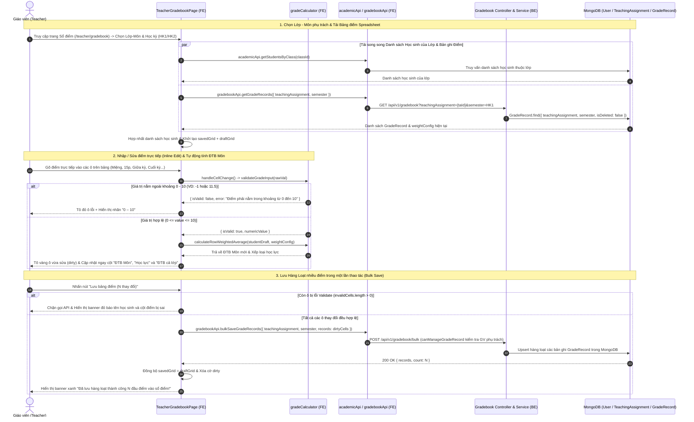

# BÁO CÁO KỸ THUẬT & NHẬT KÝ SỬ DỤNG AI (AI USAGE LOG)
## Tính năng: Giao diện Sổ điểm Dạng Bảng (Spreadsheet Gradebook), Inline Edit, Tính Điểm Trung Bình Tự động & Lưu Hàng Loạt (Jira EL66)

- **Dự án:** Hệ thống Quản lý Học tập cho Trường THPT (`Edu-LMS` — MERN Stack)
- **Mã công việc Jira:** **EL66**
- **Phạm vi báo cáo:**
  - Xây dựng giao diện sổ điểm dạng bảng tính (**Spreadsheet Gradebook** — `src/features/teacher/TeacherGradebookPage.jsx`) giúp Giáo viên nhập và cập nhật điểm trực tiếp trên từng học sinh theo Lớp – Môn học được phân công (`TeachingAssignment`) và Học kỳ (`HK1`, `HK2`, `CaNam`).
  - Hiển thị danh sách học sinh theo lớp dưới dạng ma trận 2 chiều: **Hàng là học sinh** (`STT`, `Mã HS`, `Họ và tên học sinh`), **Cột là 6 loại điểm thành phần** (`Điểm miệng`, `Điểm 15 phút`, `Điểm thường xuyên`, `Điểm 1 tiết`, `Điểm giữa kỳ`, `Điểm cuối kỳ`) kèm hệ số cấu hình (`x1`, `x2`, `x3`).
  - Triển khai cơ chế **chỉnh sửa trực tiếp trên ô (Inline Edit)** có theo dõi trạng thái thay đổi (`savedGrid` vs `draftGrid` / `dirtyCells`) và chức năng hoàn tác (`handleResetChanges`).
  - Kiểm tra hợp lệ (**Validate**) giá trị điểm trong khoảng `0 – 10` tức thời ngay khi gõ (`validateGradeInput`), tô đỏ ô vi phạm và chặn lưu khi có điểm ngoài khoảng cho phép.
  - Tự động tính và hiển thị **Điểm trung bình môn (`ĐTB Môn`)** cùng **Xếp loại học lực** theo thời gian thực ngay khi giáo viên nhập/sửa điểm (`calculateRowWeightedAverage`, `classifyAcademicPerformance`).
  - Hỗ trợ **lưu nhiều điểm trong một lần thao tác (Lưu hàng loạt / Bulk Save)** thông qua endpoint `POST /api/v1/gradebook/bulk` (`bulkSaveGradeRecords`) bên cạnh nút lưu riêng từng dòng học sinh.

---

## 1. Thông tin chung tính năng (Jira EL66)

| Hạng mục | Chi tiết |
| :--- | :--- |
| **Mã Jira & Tên công việc** | **EL66** — Xây dựng Giao diện Sổ điểm Dạng Bảng (Spreadsheet Gradebook), Inline Edit, Validate 0–10, Tính ĐTB Tự động & Lưu Hàng Loạt |
| **Mục tiêu nghiệp vụ** | Giúp Giáo viên bộ môn nhập điểm cho cả lớp (30–45 học sinh × 6 cột điểm) nhanh chóng trên một bảng tính trực quan giống Excel/Google Sheets thay vì phải mở từng hộp thoại (Modal) cho từng học sinh. Ngay khi giáo viên gõ điểm vào các ô thành phần, hệ thống kiểm tra tức thì miền giá trị `0 – 10`, tự động tính lại Điểm trung bình môn theo hệ số cấu hình, thống kê học lực toàn lớp và cho phép lưu toàn bộ các đầu điểm đã nhập/sửa chỉ với một cú nhấp chuột (**"Lưu bảng điểm"**). |
| **Phạm vi hoàn thiện** | - **Trang Sổ điểm Giáo viên (`src/features/teacher/TeacherGradebookPage.jsx`):**   + Bộ chọn Lớp – Môn phụ trách (`TeachingAssignment`) và tab chọn Học kỳ (`HK1`, `HK2`, `Cả năm`).   + 4 thẻ thống kê lớp học theo thời gian thực (`Sĩ số lớp`, `Điểm TB chung cả lớp`, `Học lực Khá/Giỏi trở lên`, `Trạng thái chỉnh sửa / Số đầu điểm chờ lưu`).   + Bảng điểm dạng Spreadsheet (`gradebook-spreadsheet-table`) với 6 cột điểm inline edit, cột `ĐTB Môn` tự động, cột `Học lực` và nút `Lưu` theo dòng.   + Thanh tìm kiếm học sinh theo tên/mã HS/email và bộ lọc theo mức học lực (`Xuất sắc`, `Giỏi`, `Khá`, `Trung bình`, `Yếu`, `Kém`, `Chưa có điểm`).   + Chức năng Lưu hàng loạt (`handleBulkSave`) và Hoàn tác thay đổi (`handleResetChanges`). - **Bộ công cụ Tính điểm & Validate (`src/utils/gradeCalculator.js`):** `DEFAULT_GRADE_WEIGHTS`, `GRADE_COLUMN_DEFINITIONS`, `validateGradeInput`, `calculateRowWeightedAverage`, `classifyAcademicPerformance`. - **API Client & Backend Bulk Upsert:** `src/api/gradebookApi.js` + endpoint `POST/PUT /api/v1/gradebook/bulk` (`bulkUpsertGradeRecords` trong `gradebook.service.js`). - **Kiểm thử tự động (Vitest):** `src/test/features/TeacherGradebookPage.test.jsx` & `src/test/utils/gradeCalculator.test.js`. |
| **Trạng thái triển khai** | **Hoàn thành (Done)** — Pass 100% Vitest Component & Utility Tests (`9/9`), ESLint (`0 errors`) và tích hợp hoàn chỉnh vào `/teacher/gradebook`. |

---

## 2. Công cụ AI

Trong quá trình thiết kế giao diện bảng điểm Spreadsheet, xây dựng bộ kiểm tra inline `0 – 10`, thuật toán tính điểm trung bình thời gian thực và chức năng lưu hàng loạt cho task **EL66**, lập trình viên đã sử dụng:
- **Công cụ chính:** **Google Antigravity AI** (Agentic AI Coding Assistant tích hợp trực tiếp trong IDE).
- **Công cụ hỗ trợ bổ sung (nếu có):** `[Cần kiểm tra/bổ sung nếu có dùng thêm ChatGPT / GitHub Copilot / Claude bên ngoài IDE]`.

---

## 3. Phiên bản / Model

- **Phiên bản / Model trên Antigravity:** `Chưa xác định trong ngữ cảnh hệ thống / Cần điền tay model cụ thể (VD: Claude Sonnet 4.5 / Gemini 2.5 Pro / GPT-5...)` `[Cần kiểm tra/bổ sung]`.

---

## 4. Prompt đã dùng

Các prompt / yêu cầu chính đã được sử dụng để triển khai và hoàn thiện **EL66**:

### Giai đoạn 1 — Xây dựng Giao diện Sổ điểm Dạng Bảng (Spreadsheet), Inline Edit & Lưu Hàng Loạt
> **Prompt 1 (EL66 - Giao diện Sổ điểm Spreadsheet):**
> *"Mô tả: Xây dựng giao diện sổ điểm dạng bảng giúp giáo viên nhập và cập nhật điểm trực tiếp trên từng học sinh.*
> *Yêu cầu chính:*
> *- Hiển thị danh sách học sinh theo lớp.*
> *- Hàng là học sinh, cột là các loại điểm.*
> *- Cho phép nhập/sửa điểm trực tiếp bằng inline edit.*
> *- Validate điểm trong khoảng 0–10.*
> *- Hiển thị điểm trung bình môn tự động.*
> *- Hỗ trợ lưu nhiều điểm trong một lần thao tác.*
> *Công việc con:*
> *- Xây dựng bảng điểm dạng spreadsheet.*
> *- Implement inline edit.*
> *- Validate giá trị điểm 0–10.*
> *- Hiển thị điểm trung bình.*
> *- Xây dựng chức năng lưu hàng loạt."*

---

## 5. Nội dung AI tạo ra

AI đã hỗ trợ đề xuất và sinh ra đầy đủ các thành phần mã nguồn cho **EL66**:

1. **Bộ Tiện ích Tính Điểm & Validate Ô Nhập Điểm (`edulms-frontend/src/utils/gradeCalculator.js`):**
   - Định nghĩa danh sách 6 cột điểm chuẩn (`GRADE_COLUMN_DEFINITIONS`: `oral`, `15min`, `regular`, `45min`, `midterm`, `final`) cùng nhãn hiển thị và hệ số mặc định (`DEFAULT_GRADE_WEIGHTS`).
   - Hàm `validateGradeInput(rawVal)`: Hỗ trợ chuẩn hóa dấu thập phân (`,` → `.`), phân biệt ô trống (`isEmpty: true, isValid: true`) với ô có dữ liệu, kiểm tra số thực hợp lệ trong khoảng `[0, 10]` và làm tròn 2 chữ số thập phân.
   - Hàm `calculateRowWeightedAverage(rowCells, weightConfig)`: Tính điểm trung bình môn (TBM) theo hệ số cấu hình cho một hàng học sinh ngay khi bất kỳ ô điểm nào trên hàng thay đổi.
   - Hàm `classifyAcademicPerformance(gpa)`: Phân loại học lực (`Xuất sắc`, `Giỏi`, `Khá`, `Trung bình`, `Yếu`, `Kém`, `Chưa xếp loại`).
2. **Tầng Dịch vụ Gọi API Sổ điểm (`edulms-frontend/src/api/gradebookApi.js`):**
   - Cung cấp các hàm `getGradeRecords`, `getGradeRecordsByTeachingAssignment`, `createGradeRecord`, `updateGradeRecord`, `deleteGradeRecord`, `bulkSaveGradeRecords` (`POST /v1/gradebook/bulk`), `getGradeWeightConfig`, `updateGradeWeightConfig`.
3. **API Backend Lưu Hàng Loạt (`bulkUpsertGradeRecords` trong `gradebook.service.js`, `gradebook.controller.js`, `gradebook.routes.js`):**
   - Endpoint `POST/PUT /api/v1/gradebook/bulk` nhận mảng `records` của nhiều học sinh và nhiều loại điểm trong một lần gọi, xác thực quyền giáo viên phụ trách `TeachingAssignment`, kiểm tra điểm `0 – 10` và thực hiện Upsert (cập nhật bản ghi điểm đã có hoặc tạo mới nếu chưa có).
4. **Trang Sổ điểm Dạng Bảng của Giáo viên (`edulms-frontend/src/features/teacher/TeacherGradebookPage.jsx`):**
   - Khung chọn Lớp – Môn học (`TeachingAssignment`) và tab chọn Học kỳ (`HK1`, `HK2`, `CaNam`).
   - Ma trận trạng thái kép `savedGrid` (dữ liệu đã lưu từ server) và `draftGrid` (dữ liệu giáo viên đang gõ inline).
   - Bảng điểm `gradebook-spreadsheet-table` gồm các hàng học sinh, 6 cột `input` inline edit, cột `ĐTB Môn` tự động, cột badge `Học lực` và nút `Lưu` từng dòng.
   - Thanh công cụ Lưu hàng loạt (`bulk-save-grades-btn`), nút Hoàn tác (`handleResetChanges`) và banner thông báo kết quả (`gradebook-status-banner`).
5. **Bộ Kiểm thử Tự động (`TeacherGradebookPage.test.jsx` & `gradeCalculator.test.js`):**
   - Kiểm thử hiển thị bảng điểm theo lớp, inline edit cập nhật ĐTB môn thời gian thực, chặn lưu khi nhập điểm ngoài khoảng `0 – 10` và lưu hàng loạt nhiều đầu điểm.

---

## 6. Phần bạn đã sửa / hoàn thiện

Trong quá trình tích hợp giữa Frontend và Backend, lập trình viên đã trực tiếp tinh chỉnh và hoàn thiện các chi tiết kỹ thuật sau:

1. **Hợp nhất Danh sách Học sinh của Lớp (`getStudentsByClass`) với Dữ liệu Bản ghi Điểm (`getGradeRecords`):**
   - Nếu chỉ hiển thị những học sinh đã có bản ghi `GradeRecord`, bảng điểm khi mới mở đầu học kỳ sẽ bị trống và giáo viên không thể nhập điểm mới.
   - Lập trình viên đã hoàn thiện `loadClassStudentsAndGrades` trong `TeacherGradebookPage.jsx`: gọi song song `academicApi.getStudentsByClass(classId)` và `gradebookApi.getGradeRecords({ teachingAssignment, semester })`, sau đó hợp nhất qua `studentMap` (sắp xếp theo mã học sinh `userCode`). Nhờ vậy, bảng điểm luôn hiển thị đầy đủ 100% danh sách học sinh của lớp với các ô trống sẵn sàng để giáo viên gõ điểm trực tiếp.
2. **Thiết kế Cơ chế So sánh Trạng thái Kép (`savedGrid` vs `draftGrid`) chỉ gửi các Ô Thay đổi (`dirtyCells`):**
   - Thay vì gửi lại toàn bộ `N học sinh × 6 cột` trong mỗi lần bấm lưu, hook `useMemo` tự động đối chiếu từng ô `draftGrid[stId][col.key]` với `savedGrid[stId][col.key].value`.
   - Chỉ những ô thực sự có thay đổi và không rỗng mới được đưa vào mảng `dirtyCells` (kèm `_id` của bản ghi cũ nếu là sửa điểm). Các ô đang chỉnh sửa được tô nền vàng nhạt (`bg-amber-50/70 border-amber-400`) giúp giáo viên dễ dàng nhận biết những điểm nào vừa mới nhập nhưng chưa lưu.
3. **Hỗ trợ nhập số thập phân bằng cả dấu chấm (`.`) và dấu phẩy (`,`) trên Bàn phím Tiếng Việt:**
   - Trong `validateGradeInput`, chuỗi nhập vào được chuẩn hóa `.replace(',', '.')` trước khi chuyển sang `Number`, giúp giáo viên gõ `8,5` hay `8.5` đều được ghi nhận hợp lệ và tự động tính ĐTB môn chính xác.
4. **Cập nhật Lưới Điểm Tại chỗ (In-place Grid Sync) sau khi Lưu Hàng Loạt:**
   - Khi `gradebookApi.bulkSaveGradeRecords` trả kết quả thành công, hệ thống tự động cập nhật `_id` và giá trị mới vào `savedGrid` cho tất cả các ô trong `dirtyCells`, chuyển trạng thái về `"Đã đồng bộ"` ngay lập tức mà không làm giật hay mất vị trí cuộn của bảng điểm.
5. **Đăng ký Route `/teacher/gradebook` vào `AppRoutes.jsx`:**
   - Khai báo `<Route path="/teacher/gradebook" element={<TeacherGradebookPage />} />` bên trong nhóm route bảo vệ `<RoleRoute allowedRoles={['teacher']}>`, khớp hoàn toàn với đường dẫn `/teacher/gradebook` đã khai báo sẵn trong `src/constants/navigation.js`.

---

## 7. Phân tích logic chi tiết (Các file đã sửa, Logic thêm vào, Luồng mới)

### 7.1. Danh sách các file đã tạo / đã sửa

| File | Trạng thái | Vai trò & Trách nhiệm |
| :--- | :---: | :--- |
| [edulms-frontend/src/features/teacher/TeacherGradebookPage.jsx](file:///g:/hcmute/tlcn/code/Edu-LMS/edulms-frontend/src/features/teacher/TeacherGradebookPage.jsx) | Tạo mới | Giao diện chính Sổ điểm dạng bảng (Spreadsheet Gradebook) cho Giáo viên: chọn Lớp – Môn & Học kỳ, hiển thị bảng học sinh × các cột điểm, xử lý inline edit, hiển thị lỗi `0–10`, tự động tính ĐTB môn & học lực, thống kê lớp và lưu hàng loạt / lưu từng dòng. |
| [edulms-frontend/src/utils/gradeCalculator.js](file:///g:/hcmute/tlcn/code/Edu-LMS/edulms-frontend/src/utils/gradeCalculator.js) | Cập nhật & Mở rộng | Định nghĩa `DEFAULT_GRADE_WEIGHTS`, `GRADE_COLUMN_DEFINITIONS`, hàm `validateGradeInput(rawVal)`, `calculateRowWeightedAverage(rowCells, weightConfig)`, `classifyAcademicPerformance(gpa)`, `calculateSubjectGPA`, `calculateOverallGPA`. |
| [edulms-frontend/src/api/gradebookApi.js](file:///g:/hcmute/tlcn/code/Edu-LMS/edulms-frontend/src/api/gradebookApi.js) | Tạo mới | Tầng gọi API sổ điểm: `getGradeRecords`, `createGradeRecord`, `updateGradeRecord`, `deleteGradeRecord`, `bulkSaveGradeRecords` (`POST /v1/gradebook/bulk`), `getGradeWeightConfig`, `updateGradeWeightConfig`. |
| [edulms-frontend/src/api/index.js](file:///g:/hcmute/tlcn/code/Edu-LMS/edulms-frontend/src/api/index.js) | Cập nhật | Export `gradebookApi` trong danh mục API trung tâm của Frontend. |
| [edulms-frontend/src/routes/AppRoutes.jsx](file:///g:/hcmute/tlcn/code/Edu-LMS/edulms-frontend/src/routes/AppRoutes.jsx) | Cập nhật | Gắn route `/teacher/gradebook` trỏ tới `TeacherGradebookPage` dưới quyền `teacher`. |
| [edulms-backend/src/services/gradebook.service.js](file:///g:/hcmute/tlcn/code/Edu-LMS/edulms-backend/src/services/gradebook.service.js) | Cập nhật | Bổ sung hàm `bulkUpsertGradeRecords(payload, context)` hỗ trợ lưu hàng loạt nhiều đầu điểm của nhiều học sinh trong một giao dịch API. |
| [edulms-backend/src/controllers/gradebook.controller.js](file:///g:/hcmute/tlcn/code/Edu-LMS/edulms-backend/src/controllers/gradebook.controller.js) | Cập nhật | Bổ sung controller `bulkUpsertGradeRecords`. |
| [edulms-backend/src/routes/gradebook.routes.js](file:///g:/hcmute/tlcn/code/Edu-LMS/edulms-backend/src/routes/gradebook.routes.js) | Cập nhật | Bổ sung route `POST /api/v1/gradebook/bulk` và `PUT /api/v1/gradebook/bulk` gắn middleware `canManageGradeRecord`. |
| [edulms-frontend/src/test/features/TeacherGradebookPage.test.jsx](file:///g:/hcmute/tlcn/code/Edu-LMS/edulms-frontend/src/test/features/TeacherGradebookPage.test.jsx) | Tạo mới | Bộ kiểm thử giao diện Vitest cho `TeacherGradebookPage` (hiển thị bảng điểm theo lớp, inline edit & tự động cập nhật ĐTB môn, validate điểm ngoài `0–10` và lưu hàng loạt). |
| [edulms-frontend/src/test/utils/gradeCalculator.test.js](file:///g:/hcmute/tlcn/code/Edu-LMS/edulms-frontend/src/test/utils/gradeCalculator.test.js) | Cập nhật | Bổ sung unit test cho `validateGradeInput`, `calculateRowWeightedAverage` và `classifyAcademicPerformance`. |

---

### 7.2. Những logic cốt lõi đã thêm vào

#### 1. Bảng điểm Dạng Spreadsheet Hiển thị Danh sách Học sinh theo Lớp
- Bảng điểm (`data-testid="gradebook-spreadsheet-table"`) được thiết kế chuẩn dạng lưới bảng tính:
  - **Trục dọc (Rows):** Mỗi dòng biểu diễn một học sinh trong lớp (`data-testid="gradebook-row-{studentId}"`), hiển thị `STT`, `Mã HS` (`userCode`), `Họ và tên học sinh` (`fullName`) và `Email`.
  - **Trục ngang (Columns):** Render động từ cấu hình `GRADE_COLUMN_DEFINITIONS`:
    1. `Miệng` (`oral` — Hệ số `x1`)
    2. `15 phút` (`15min` — Hệ số `x1`)
    3. `Thường xuyên` (`regular` — Hệ số `x1`)
    4. `1 tiết` (`45min` — Hệ số `x2`)
    5. `Giữa kỳ` (`midterm` — Hệ số `x2`)
    6. `Cuối kỳ` (`final` — Hệ số `x3`)
    7. `ĐTB Môn (Tự động)` — Cột tổng hợp tô nền xanh nhạt (`bg-blue-50/30`).
    8. `Học lực` — Badge phân loại màu sắc theo mức điểm.
    9. `Thao tác` — Nút **"Lưu"** nhanh cho riêng dòng học sinh đó.

#### 2. Cơ chế Inline Edit & Validate Giá trị Điểm `0 – 10`
- Mỗi ô giao nhau giữa `(studentId, col.key)` là một phần tử `<input type="text" inputMode="decimal" data-testid="grade-input-{studentId}-{col.key}">` liên kết trực tiếp với `draftGrid[studentId][col.key]`.
- Khi giáo viên gõ điểm vào ô, `handleCellChange(studentId, col.key, value)` cập nhật `draftGrid` và kích hoạt `validateGradeInput(rawVal)`:
  - **Trạng thái bình thường (Chưa sửa):** Viền xám nhạt (`border-slate-200 bg-white`).
  - **Trạng thái đã sửa & hợp lệ (`isDirty && check.isValid`):** Viền và nền vàng hổ phách (`border-amber-400 bg-amber-50/70 text-amber-900`), báo hiệu ô có thay đổi đang chờ lưu.
  - **Trạng thái lỗi Validate (`!check.isValid` — ví dụ nhập `-1`, `11.5`, `abc`):** Ô lập tức chuyển sang viền và nền đỏ (`border-red-500 bg-red-50 text-red-800`), hiển thị dòng chữ cảnh báo đỏ `0 – 10` (`data-testid="grade-error-{studentId}-{col.key}"`) ngay bên dưới ô, đồng thời đưa thông tin ô lỗi vào danh sách `invalidCells`.

#### 3. Tính và Hiển thị Điểm Trung Bình Môn Tự động theo Thời gian thực
- Hook `useMemo` (`rowsWithAverages`) tính toán lại tức thì mỗi khi `draftGrid` hoặc `weightConfig` thay đổi:
  - Gọi `calculateRowWeightedAverage(studentDraft, weightConfig)` cho từng học sinh:
    $$\text{ĐTB Môn} = \text{round}\left(\frac{\sum_{\text{col}} (\text{numericValue}_{\text{col}} \times \text{weight}_{\text{col}})}{\sum_{\text{col}} \text{weight}_{\text{col}}}, 1\right)$$
  - Chỉ những cột điểm đã nhập giá trị hợp lệ trong khoảng `[0, 10]` mới được đưa vào tử số và mẫu số hệ số.
  - Ngay lập tức cập nhật ô `data-testid="student-average-{studentId}"`, badge học lực `data-testid="student-performance-{studentId}"` và thẻ **"Điểm TB chung cả lớp"** (`data-testid="class-average-stat"`).

#### 4. Chức năng Lưu Nhiều Điểm trong Một Lần Thao tác (Lưu Hàng Loạt / Bulk Save)
- Khi giáo viên bấm nút **"Lưu bảng điểm (X thay đổi)"** (`handleBulkSave`):
  1. **Kiểm tra lỗi Validate trước khi gửi:** Nếu `invalidCells.length > 0`, hệ thống chặn gọi API và bật banner lỗi đỏ chỉ rõ:
     > *"Không thể lưu! Điểm '<Tên cột>' của học sinh <Họ tên> (<Giá trị sai>) không hợp lệ. Điểm phải nằm trong khoảng từ 0 đến 10."*
  2. **Đóng gói Batch Payload:** Nếu tất cả các ô đều hợp lệ, hệ thống gom toàn bộ `dirtyCells` của nhiều học sinh thành mảng `recordsPayload` và gửi **1 request duy nhất** tới `gradebookApi.bulkSaveGradeRecords({ teachingAssignment, semester, records: recordsPayload })`.
  3. **Upsert phía Backend & Đồng bộ UI:** Backend (`bulkUpsertGradeRecords`) cập nhật các đầu điểm đã có hoặc tạo mới các đầu điểm chưa có trong MongoDB; Frontend nhận phản hồi, đồng bộ `savedGrid = draftGrid`, đặt lại số thay đổi chờ lưu về `0` (`"Đã đồng bộ"`) và hiển thị banner xanh thông báo:
     > *"Đã lưu hàng loạt thành công N đầu điểm vào sổ điểm!"*

---

### 7.3. Luồng xử lý mới (End-to-End Flow)

---

## 8. Bảng AI Usage Log cho từng công việc trên Jira (EL66)

| Jira ID | Công việc con / Hạng mục | Công cụ AI | Phiên bản / Model | Mục đích sử dụng AI | Tóm tắt kết quả AI tạo | Phần chỉnh sửa / Hoàn thiện của Dev | Trạng thái |
| :---: | :--- | :--- | :--- | :--- | :--- | :--- | :---: |
| **EL66** | **1. Xây dựng bảng điểm dạng spreadsheet** | Google Antigravity AI | `[Cần kiểm tra/bổ sung]` | Thiết kế giao diện bảng điểm ma trận với hàng là danh sách học sinh theo lớp và cột là các loại điểm thành phần kèm hệ số. | Xây dựng `TeacherGradebookPage.jsx` với bộ chọn Lớp – Môn (`TeachingAssignment`), tab Học kỳ (`HK1`, `HK2`, `CaNam`), thanh tìm kiếm/lọc học lực và bảng `gradebook-spreadsheet-table`. | Hợp nhất danh sách học sinh từ `academicApi.getStudentsByClass(classId)` với dữ liệu từ `gradebookApi.getGradeRecords` để luôn hiển thị đầy đủ 100% học sinh của lớp ngay cả khi chưa có điểm nào được nhập; gắn route `/teacher/gradebook` vào `AppRoutes.jsx`. | Hoàn thành |
| **EL66** | **2. Implement inline edit** | Google Antigravity AI | `[Cần kiểm tra/bổ sung]` | Cho phép giáo viên nhập và chỉnh sửa điểm trực tiếp ngay tại từng ô của bảng mà không cần mở modal. | Thiết kế hệ thống ô `<input>` inline trên từng cặp `(studentId, gradeType)`, quản lý qua 2 lưới trạng thái `savedGrid` và `draftGrid` cùng hàm `handleCellChange`. | Bổ sung nhận diện và đánh dấu màu vàng cam (`border-amber-400 bg-amber-50/70`) cho các ô có thay đổi chưa lưu (`isDirty`), bộ đếm `"X đầu điểm chờ lưu"` và nút **"Hoàn tác"** (`handleResetChanges`) để khôi phục nhanh về dữ liệu gốc. | Hoàn thành |
| **EL66** | **3. Validate giá trị điểm 0–10** | Google Antigravity AI | `[Cần kiểm tra/bổ sung]` | Kiểm tra tức thời mọi giá trị điểm nhập vào phải nằm trong khoảng hợp lệ từ `0` đến `10`. | Xây dựng hàm `validateGradeInput(rawVal)` trong `src/utils/gradeCalculator.js` và tích hợp kiểm tra trực tiếp trên từng ô input cũng như trước khi lưu. | Hỗ trợ nhập số thập phân bằng cả dấu phẩy `,` và dấu chấm `.`, tô viền đỏ (`border-red-500 bg-red-50`) kèm nhãn `0 – 10` ngay dưới ô sai và hiển thị thông báo lỗi chỉ rõ tên học sinh + tên cột điểm vi phạm khi bấm lưu. | Hoàn thành |
| **EL66** | **4. Hiển thị điểm trung bình** | Google Antigravity AI | `[Cần kiểm tra/bổ sung]` | Tự động tính và hiển thị Điểm trung bình môn (TBM) theo hệ số cấu hình ngay khi giáo viên nhập hoặc sửa điểm. | Xây dựng hàm `calculateRowWeightedAverage(rowCells, weightConfig)` và `classifyAcademicPerformance(gpa)` trong `gradeCalculator.js`, hiển thị tại cột **ĐTB Môn** và **Học lực**. | Tính toán reactive theo thời gian thực qua `useMemo` (`rowsWithAverages`) và tổng hợp thêm 3 chỉ số thống kê lớp học ở đầu trang (`Sĩ số lớp`, `Điểm TB chung cả lớp`, `Số học sinh Khá/Giỏi trở lên`). | Hoàn thành |
| **EL66** | **5. Xây dựng chức năng lưu hàng loạt** | Google Antigravity AI | `[Cần kiểm tra/bổ sung]` | Hỗ trợ lưu nhiều đầu điểm của nhiều học sinh trong một lần thao tác duy nhất. | Xây dựng hàm `handleBulkSave` trong `TeacherGradebookPage.jsx`, `bulkSaveGradeRecords` trong `gradebookApi.js` và endpoint `POST/PUT /api/v1/gradebook/bulk` (`bulkUpsertGradeRecords`) ở Backend. | Tối ưu chỉ gom gửi các ô thực sự có thay đổi (`dirtyCells`), đồng bộ tại chỗ `savedGrid` sau khi lưu thành công mà không cần tải lại toàn bộ trang, hỗ trợ thêm nút **"Lưu"** cho từng dòng học sinh và viết bộ test tự động trong `TeacherGradebookPage.test.jsx`. | Hoàn thành |

