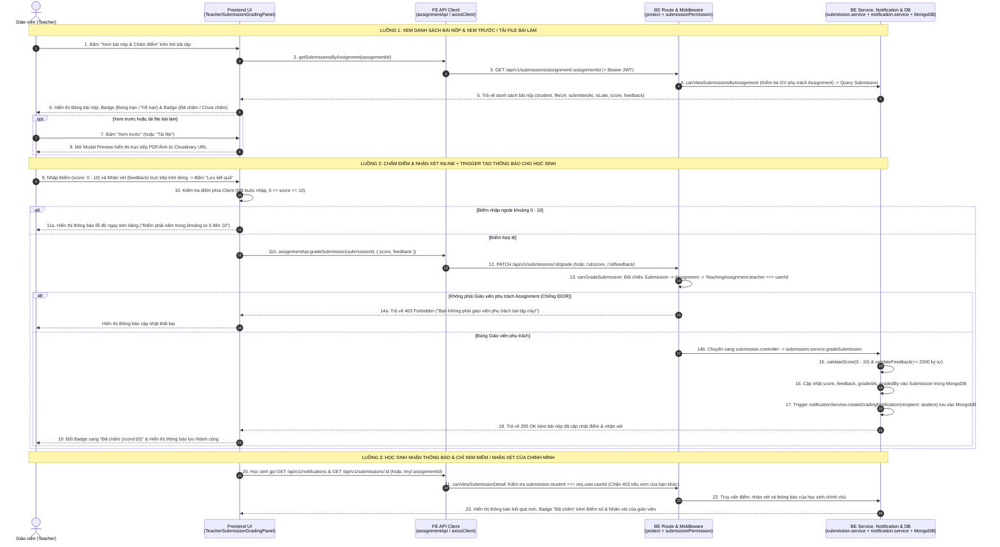
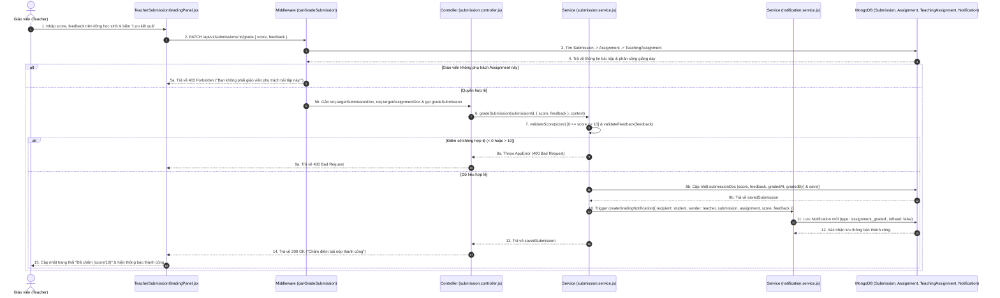

# Sơ đồ Sequence Diagram - Chức năng Giáo viên Chấm điểm, Gửi Nhận xét & Tạo Thông báo cho Học sinh

Tài liệu này mô tả chi tiết luồng hoạt động giữa **Giao diện Giáo viên (`TeacherSubmissionGradingPanel`)**, **Hệ thống API Chấm bài (`submission.service`)**, **Dịch vụ Thông báo (`notification.service`)** và **Học sinh**.

---

## 1. Sơ đồ 1: Sequence Diagram Tổng hợp FE ⇄ BE (Gọn 5 cột – Đầy đủ các luồng chính)

---

## 2. Sơ đồ 2: Sequence Diagram Chi tiết Phân tầng Backend (Middleware $\rightarrow$ Controller $\rightarrow$ Submission Service $\rightarrow$ Notification Service $\rightarrow$ MongoDB)

